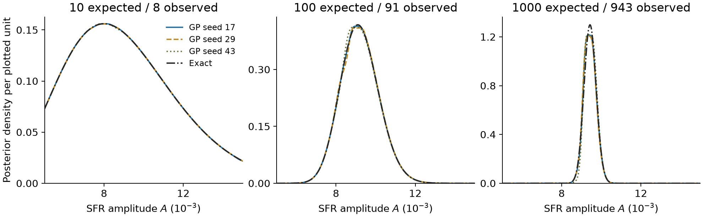
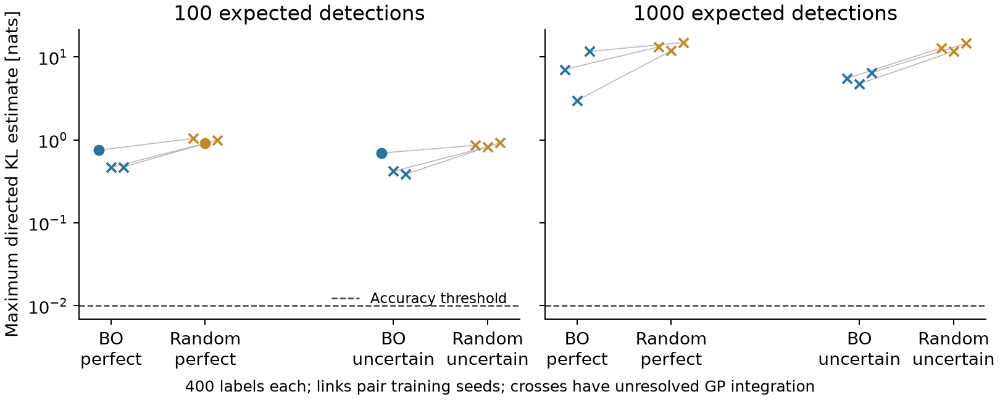

# Explicit SFR amplitude pilot — results

The bounded pilot is complete. The four-input GP is not validated at the tested 400-label budget.

## Conditional amplitude

Fixed shape, 33 training labels, three scrambled Sobol designs per catalogue size. The count draws are 8, 91 and 943. Eight of nine GPs pass the accuracy gates; the 943-event seed-43 fit fails. These are three count realizations, not nine independent catalogues.

| Expected / observed | Maximum KL across seeds [nats] | Accurate seeds | Exact bounded fractional SD | Unbounded Gamma fractional SD |
|---|---:|---:|---:|---:|
| 10 / 8 | 9.28638e-07 | 3/3 | 0.26231 | 0.33333 |
| 100 / 91 | 0.000354745 | 3/3 | 0.10426 | 0.10426 |
| 1000 / 943 | 0.0192687 | 2/3 | 0.03255 | 0.03255 |

The bounded prior is Uniform(0.005, 0.015). The unbounded benchmark is 1/sqrt(Nobs+1), not exactly 1/sqrt(Nobs). Direct trapezoidal CDFs agree with the analytic truncated Gamma to 2.04e-08 maximum absolute error.



## Joint four-input GP

Two saved latent catalogues (100 and 1000 expected detections), each with perfect/uncertain views, three training seeds and matched BO/random continuations give 24 fits. All 24 completed at 400 labels. None passes the full posterior gate: 3 are numerically resolved and inaccurate; 21 have unresolved GP integration. All four direct reference checks and analytic-amplitude parity checks pass.

| Expected | View | Strategy | Accurate / inaccurate / unresolved | KL estimate range [nats] | Direct-weighted centered lnL RMSE range |
|---|---|---|---|---:|---:|
| 100 | perfect | bo | 0 / 1 / 2 | 0.466–0.753 | 1.09–2.35 |
| 100 | perfect | random | 0 / 1 / 2 | 0.91–1.04 | 1.65–1.83 |
| 100 | uncertain | bo | 0 / 1 / 2 | 0.387–0.695 | 0.891–2.2 |
| 100 | uncertain | random | 0 / 0 / 3 | 0.825–0.923 | 1.58–1.75 |
| 1000 | perfect | bo | 0 / 0 / 3 | 3–11.7 | 6.08–11.1 |
| 1000 | perfect | random | 0 / 0 / 3 | 11.9–15 | 11.4–12.8 |
| 1000 | uncertain | bo | 0 / 0 / 3 | 4.75–6.49 | 8.24–13.2 |
| 1000 | uncertain | random | 0 / 0 / 3 | 11.7–14.6 | 11.7–12.9 |

BO has the lower KL estimate in 12/12 pairs. Most GP integrations are unresolved, so this is directional diagnostic evidence, not a validated efficiency ratio. The large-batch 25/75 sampling recipe is a new pilot policy; it is not the historical three-member optimized acquisition. There was no online stopping test.



## Interpretation and next decision

- The conditional Gamma calculation supplies a useful known-answer check, and already exposes a high-count GP miss.
- Do not replace the validated marginalized workflow or rerun the large campaign with this four-input configuration.
- The next useful experiment is a bounded comparison using the existing small-batch acquisition generalized to four inputs, with the failed pilot preserved. This separates fourth-coordinate difficulty from the changed acquisition/batch schedule.
- Reference integration must also cover inaccurate, broader GP posteriors before precise joint-KL claims. Keep current unresolved cases explicit; do not interpret them as posterior passes.
- These tests do not validate finite-population sufficiency, grid information loss, GP variance calibration, or NUTS sampling. Adaptive pixels remain deferred.

## Reproduction and verification

Run from the repository root, using a new output directory:

```sh
OPENBLAS_NUM_THREADS=1 OMP_NUM_THREADS=1 MPLCONFIGDIR=/tmp/compas-amplitude-mpl .venv/bin/python docs/studies/amplitude_gp/run_pilot.py --output NEW_DIRECTORY
.venv/bin/python docs/studies/amplitude_gp/summarize.py NEW_DIRECTORY
```

A separate saved-run audit verifies all 24 checkpoint/source hashes and paired initial designs. It checks 192 labels against physical rate evaluations at the actual amplitude, agreeing within 7.3e-12 in log likelihood; perfect/uncertain catalogue pairing also passes. See `verification.json` and `verify_run.py`. Both rendered diagnostic figures were visually inspected.

The numerical likelihood-integration, proposal-density, support and invalid-input tests pass. The fast suite passed 177 tests, with three heavy/network tests deselected and one existing Matplotlib warning. Production defaults and the manuscript are unchanged. No commits or remote writes.

The training timer excludes the shared initial-label evaluation, loader setup, and offline reference work. It must not be quoted as an end-to-end benchmark. Source hashes, catalogue hashes, saved labels, checkpoints, per-scramble scores and progress records are retained in this directory.
