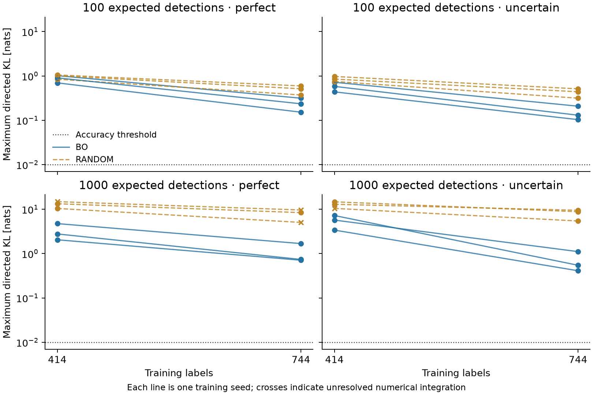
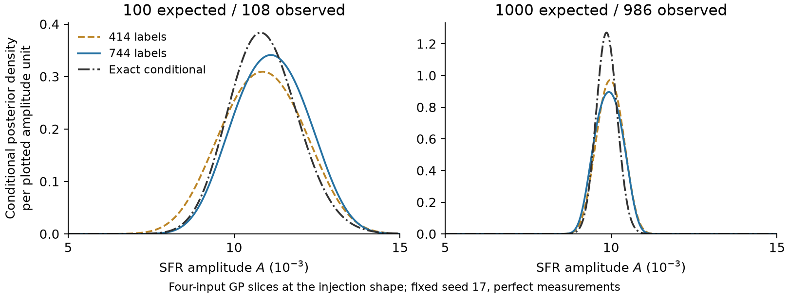
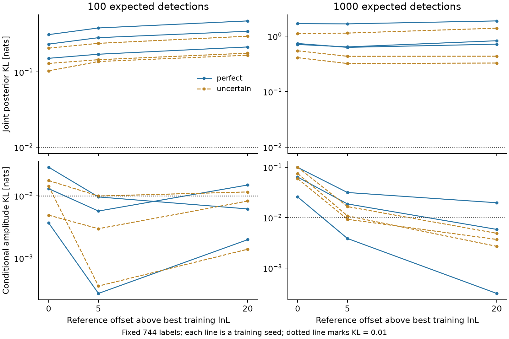

# Four-input GP: small-batch follow-up

The matched follow-up is complete: 24 trajectories, two scored budgets each. This tests the same two latent catalogues as the preceding pilot; it is not fresh-catalogue confirmation.

## Joint posterior accuracy

All training uses batches of three, immediate conditioning, hyperparameter refits every 30 labels, and the full prior with every training point retained. BO uses the existing optimized GPry-form acquisition generalized to four inputs; random uses IID prior draws. Initial 144-label designs are paired.

| Expected | View | Method | 414: accurate / inaccurate / unresolved | 744: accurate / inaccurate / unresolved | 744 KL range [nats] |
|---|---|---|---|---|---:|
| 100 | perfect | bo | 0 / 3 / 0 | 0 / 3 / 0 | 0.1524–0.3151 |
| 100 | perfect | random | 0 / 3 / 0 | 0 / 3 / 0 | 0.3727–0.5962 |
| 100 | uncertain | bo | 0 / 3 / 0 | 0 / 3 / 0 | 0.1035–0.208 |
| 100 | uncertain | random | 0 / 3 / 0 | 0 / 3 / 0 | 0.3155–0.5127 |
| 1000 | perfect | bo | 0 / 3 / 0 | 0 / 3 / 0 | 0.7081–1.68 |
| 1000 | perfect | random | 0 / 2 / 1 | 0 / 1 / 2 | 5.037–9.619 |
| 1000 | uncertain | bo | 0 / 3 / 0 | 0 / 3 / 0 | 0.4093–1.106 |
| 1000 | uncertain | random | 0 / 2 / 1 | 0 / 3 / 0 | 5.43–9.469 |

Increasing 414 → 744 labels lowers the KL estimate in 24/24 trajectories. At 744 labels, BO has lower KL in 10/10 numerically resolved matched pairs. The median random/BO KL ratio is 3.74. These are error comparisons at fixed budgets, not speedup factors or validated stopping results.

## Resolving the previous numerical ambiguity

The unchanged original 400-label checkpoints now have 0 accurate, 21 inaccurate and 3 unresolved outcomes under refined scoring. No original label or checkpoint was changed. Initial one-amplitude-draw results remain archived.

Scoring now balances uniform and conditional-Gamma amplitude proposals, stratified within each component. Each shape point receives 16 amplitude draws, with a bounded refinement to 64 for unresolved cases. The two shape designs remain independent full-support numerical integrations; exact rates are reused only offline. Direct references must agree with the analytic marginalized-plus-conditional reconstruction. GP moments, intervals and both KL directions must also agree across designs.

The conservative importance-ESS lower bound after accounting for repeated shape coordinates is 410.4 (required ≥100). Replicated amplitude points are not counted as independent catalogues or independent shape draws.

414-label results are a near-budget comparison with the old 400-label fits, not an exactly matched test of batch size. The acquisition rule and refit schedule both changed; the old/new contrast does not isolate only batch size.

## Known-answer amplitude test within the four-input GP

Fix the three shape parameters at their injection values and evaluate the trained four-input GP over amplitude. Compare with the exact truncated Gamma using the same prior. These are conditional slices of a joint GP, not separately trained one-dimensional models and not marginalized amplitude posteriors.

| Expected | Method | Accurate slices at 414 | Accurate slices at 744 |
|---|---|---:|---:|
| 100 | bo | 0/6 | 2/6 |
| 100 | random | 0/6 | 0/6 |
| 1000 | bo | 0/6 | 0/6 |
| 1000 | random | 0/6 | 0/6 |

## Optimizer-iteration check

Hold the 744 selected labels and target transform fixed, using perfect-measurement seed 17 at each count. Refit from identical initial conditions with 250, 1500 and 3000 Adam steps. Fit all variants before reference scoring.

| Expected | Steps | Final negative GP marginal log likelihood | Posterior KL [nats] | Outcome |
|---|---:|---:|---:|---|
| 100 | 250 | 166635 | 0.3151 | inaccurate |
| 100 | 1500 | 60611.5 | 0.31401 | inaccurate |
| 100 | 3000 | 37905.8 | 0.34024 | inaccurate |
| 1000 | 250 | 937710 | 1.6804 | inaccurate |
| 1000 | 1500 | 348848 | 1.4536 | inaccurate |
| 1000 | 3000 | 218362 | 1.4728 | inaccurate |

Improving the GP fitting objective is not itself evidence of posterior accuracy; judge the direct-reference column. This checks two frozen datasets, not all optimizer choices or kernels.

## Smoothing the square-root reference

An exploratory fixed-label ablation places the square-root transform reference 5 or 20 lnL above the best training label. This avoids the transform cusp at that label while retaining its original scale, floor, all 744 labels, fixed noise and 250 optimizer steps. All twelve BO fits are tested at both offsets. The numerical reference maximum and injection are not used to choose the offset. No production setting changed.

| Reference offset | Joint accurate / inaccurate / unresolved | Accurate conditional amplitude slices |
|---|---|---:|
| +5 | 0 / 12 / 0 | 7/12 |
| +20 | 0 / 12 / 0 | 9/12 |

This is a fit-only investigation on already examined catalogues. It does not validate acquisition with a changed transform from the start. A successful conditional amplitude check is necessary evidence, but cannot substitute for the joint posterior comparison.

## Decision and limits

- Keep the validated amplitude-marginalized workflow as the reference. This experiment does not authorize replacing it.
- The explicit amplitude remains a useful known-answer diagnostic. A joint GP must recover both this conditional law and the full posterior.
- More labels help in the measured cases, but extrapolating a required budget or certifying a universally adequate four-input GP is unsupported.
- These results isolate approximation to a fixed finite-population likelihood. They do not test independent COMPAS realizations, finer grids, prior-wide calibration, GP variance calibration, missed modes or NUTS correctness.

## Reproducibility and checks

The new dimension-independent acquisition matches the historical three-input function in a seeded parity test. Four-input coordinates are checked for novelty, bounds and reproducibility; stratified importance weights are tested against uniform-prior integrals and truncated-Gamma moments, including tail/underflow cases. The reference-offset round trip, unchanged scale/floor and smooth peak derivative are also tested. The full fast suite passed 182 tests (three heavy/network tests deselected; one existing Matplotlib warning).

The final saved-run audit checks all 24 trajectories, 48 checkpoint hashes and 4800 pre-training batches. All source snapshots and paired initial designs match. An independent check of 192 labels through physical rate evaluations agrees within 1.46e-11 lnL; the catalogue exposure/count scaling used in the Gamma-slice test also passes. See `verification.json`. All three rendered figures were visually inspected.

Sources and protocol were frozen before training in `manifest.json` and `source_snapshot/`. Per-job `complete.json`, `history.json`, `batches.json`, `scores.json`, and independent-reference metadata retain costs, predictions made before adding labels, checkpoint hashes, initial/refined numerical attempts and outcomes. Training times exclude shared initial-data construction and offline references; do not infer end-to-end speedup.

Run `small_batch_followup.py --output NEW_DIRECTORY --stage train`, followed by the same command with `--stage score`. `conditional_slices.py`, `optimizer_check.py` and `rescore_large_batch.py` provide the separate controls. Run this summarizer after all controls finish. Production defaults, prior, grid and manuscript remain unchanged. No commits or remote writes.
