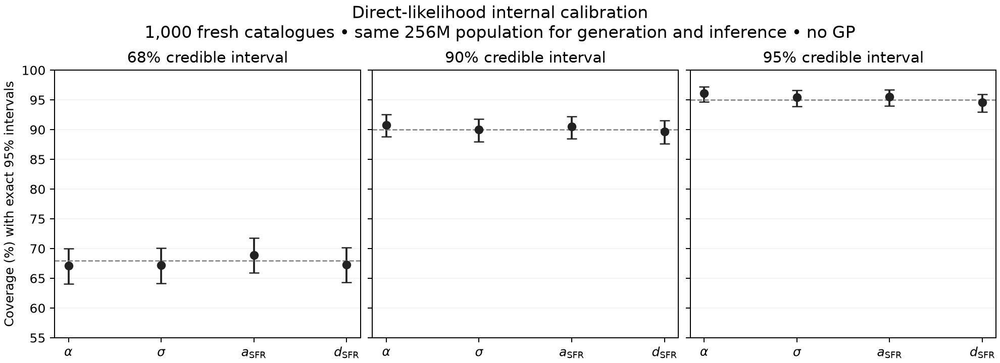

# Independent direct-likelihood calibration control

2026-09-09. The alpha coverage deficit in the fresh 100-catalogue GP experiment
was shared by the direct likelihood and remained when that same ensemble used
the generation population for inference. We therefore fixed a larger independent
direct-only experiment before generating its catalogues. No GP was fitted.

## Design

1000 fresh prior-drawn truths, seed 20261025; 0.1-year ideal binned Poisson
observations; fixed full prior, mass10 grid, mass support and selection model.
Generation and inference both use blocks 0–7 of the existing COMPAS population.
Two independent 16384-point Sobol integrations use seeds 20261026 and 20261027.
Posterior CDFs at the true parameters give equal-tailed containment decisions;
the amplitude CDF uses its analytic truncated-Gamma conditional mixture.
All 1000 catalogues are retained. No seed selection or pooling with the earlier
ensemble was performed. This follow-up was motivated by the earlier deficit.

## Results

| Parameter | 68% coverage | 90% coverage | 95% coverage |
| --- | --- | --- | --- |
| alpha | 671/1000 | 908/1000 | 961/1000 |
| sigma | 672/1000 | 900/1000 | 954/1000 |
| a_SFR | 689/1000 | 905/1000 | 955/1000 |
| d_SFR | 673/1000 | 897/1000 | 946/1000 |

Every nominal level lies within its individual exact 95% binomial interval.
These are not simultaneous confidence bounds or proof of exact calibration.
The two numerical scrambles change at most two containment decisions per
parameter/level (0.2 percentage points). Runtime was 107.0 seconds.

The earlier alpha deficit did not persist in this larger independent direct-only
control. The result supports internal calibration of the matched numerical model.
It does not erase the original deficit, independently validate 1000 GP fits,
test disjoint-population mismatch, or establish astrophysical model adequacy.
The GP accuracy claim remains based on the separate 100-catalogue confirmation.



## Reproduction and retained evidence

```sh
MPLCONFIGDIR=/tmp/compas-grid-matplotlib .venv/bin/python docs/studies/joint_pilot/direct_rank_control.py
MPLCONFIGDIR=/tmp/compas-grid-matplotlib .venv/bin/python docs/studies/joint_pilot/plot_direct_rank_control.py
```

`direct_rank_control_results/` contains all catalogue truths/counts, posterior
ranks from both scrambles, summary JSON with exact binomial intervals and
numerical differences, and PNG/PDF figures. The posterior-rank calculation is
checked against the full analytic posterior-summary helper in the fast tests.
