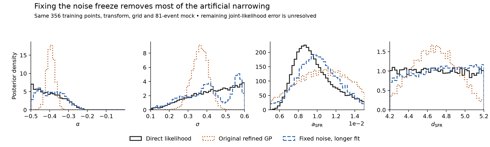
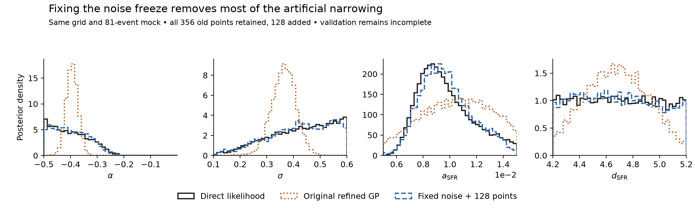

# The noise-freezing bug and its posterior impact

**The narrow alpha/sigma peaks in the original figure were substantially caused
by a real implementation bug.** `optimise_noise=False` applied `stop_gradient`
once to the initial noise array. GPJax subsequently differentiated a new model
argument on every optimizer step, so this did not keep the parameter fixed.

The intended transformed-space noise standard deviation was sqrt(1e-5) =
0.0031623. Saved original/refined models instead contain 5.0841 / 5.0052. These
are learned GP noise values, not measured COMPAS sampling uncertainty. In the
old refined model, kernel variance was only 2.802, while noise variance was ~25.
The fit could absorb deterministic likelihood structure into observation noise.

The repair in `fit_exact_gp` wraps the **constrained scalar** in
`paramax.NonTrainable`, which applies stop-gradient whenever the training loss
unwraps the model. Wrapping a nested parameter object directly is incompatible
with the runtime's single-level prediction unwrapping; the constrained scalar
also preserves prediction/checkpoint support. No public signature or defaults
changed: the false flag now does what it promises. The true flag remains trainable.
A regression test performs actual optimization and verifies both behaviors.

Earlier experiments specifying fixed GPJax noise must not be interpreted as
fixed-noise experiments without rerunning. Their numerical results still describe
the saved old models. They do not establish stationary-kernel misspecification
as the cause of this figure.

## Controlled comparisons

All comparisons below use the original ideal 81-event catalogue, 32M population,
mass10 grid, full prior, Matérn-5/2 kernel, original sqrt transform/floor, seed 17,
and four NUTS chains. The first three retain exactly the same 356 locations and
labels. Scores use a shared set of 256 direct-posterior locations, never used for
training. These scores therefore differ from the earlier GP-posterior-location
scores (~2.64 lnL); compare within this table.

| Fit | Noise SD | Centered held-out lnL RMS | alpha 68% width / direct | sigma 68% width / direct | SFR a width / direct | SFR d width / direct |
|---|---:|---:|---:|---:|---:|---:|
| Original refined, 250 steps | 5.005 | 5.451 | 0.283 | 0.336 | 1.327 | 0.723 |
| Fixed noise, 250 steps | 0.003162 | 1.434 | 0.930 | 1.152 | 1.300 | 0.928 |
| Fixed noise, 2000 steps | 0.003162 | 1.066 | 0.935 | 1.095 | 1.038 | 0.984 |
| Fixed noise, 2000 steps, +128 locations | 0.003162 | 0.530 | 0.938 | 0.978 | 0.951 | 0.975 |

The matched 250-step comparison isolates the freeze. Increasing optimization
steps is a separate change. The old marginal-likelihood objective was still
falling substantially at step 250, so there was also no evidence it had converged.
Training-point lnL error (against the existing transformed/floored labels) falls
from RMS 1086.6 in the old refined fit to 0.0102 with the repair at 250 steps and
0.0032 at 2000 steps. Held-out error remains much larger, exposing interpolation
error after training-point fitting is repaired.



The +128 experiment draws new training locations from the repaired 2000-step
GP posterior, using seed 20260921. It retains every previous point, including
the tails, and keeps the original transform. It is not a restricted-prior or
oracle-truth-parameter experiment. It uses the existing direct reference only
for assessment. Means are within 0.047 direct SD; all measured 68%/95% widths are
within 6.2%; maximum interval-endpoint difference is 0.171 direct SD. Sampler
checks pass: maximum R-hat 1.00223, minimum bulk ESS 1999, zero divergences.



## Remaining limitations and a rejected transform experiment

The original transform caps values above its initial reference of -60.28469.
39 of the 256 direct-posterior checks exceed that reference; their maximum is
about -59.99512. Thus this limitation does occur, although the initial GP's own
validation locations did not expose it. It is not evidence that capping caused
most of the severe narrowing: the noise-only change already removes most of it.

A separate experiment anchored the sqrt transform at the saturated Poisson
upper bound (-14.88480), retaining its scale, floor, training points and corrected
noise. That worsened held-out RMS to 2.935 and failed sampler diagnostics. It is
**rejected**, not promoted to defaults. A mathematically valid bound alone does
not ensure an easy-to-interpolate transformed surface.

Fresh validation after the +128 experiment excludes all training locations and
all earlier scoring locations:

| Source of 256 fresh locations | Centered lnL RMS | Maximum centered error |
|---|---:|---:|
| Direct posterior | 0.579 | 4.248 |
| Repaired GP posterior | 0.660 | 3.984 |

Maximum difference in parameter correlation coefficients is 0.075. The marginal
constraints are greatly improved, but the ~0.1 lnL engineering target remains
unmet, and local/joint inaccuracies remain. Do not claim calibrated coverage or
transfer these results to 512M/LVK without testing. No extra variance correction
was introduced; the population bootstrap uncertainty was not used as GP noise.

## Reproduction

Run from the repository root with `MPLCONFIGDIR=/tmp/compas-grid-matplotlib`:

```bash
.venv/bin/python docs/studies/joint_pilot/diagnose_gp_noise.py
.venv/bin/python docs/studies/joint_pilot/diagnose_gp_transform.py
.venv/bin/python docs/studies/joint_pilot/refine_fixed_noise.py
.venv/bin/python docs/studies/joint_pilot/check_repaired_gp.py
.venv/bin/python docs/studies/joint_pilot/plot_noise_fix.py
.venv/bin/python docs/studies/joint_pilot/plot_noise_fix.py --refined
```

Outputs are retained under `noise_freeze_results/`, separate from the original
models. Experimental scripts overwrite their own outputs on rerun. The manifest
records source/script hashes and the original model identity. The fast suite has
42 passing tests, 3 heavy/network deselections, and one pre-existing Matplotlib
warning. No commit/push performed.

**Next:** test the amplitude-marginalized 3D target with noise actually fixed;
its earlier result also used the faulty freeze. Keep a fresh posterior-location
assessment and direct constraint comparison. Confirm across independent training
seeds before restarting the larger calibration study. Avoid attributing remaining
error to a kernel family until the repaired training procedure has been assessed.


Latest follow-up: [repaired reduced GP validation](REDUCED_GP_VALIDATION.md) records three fresh training seeds, 512M transfer and the completed 20-catalogue pilot. Earlier failed experiments remain historical evidence.
