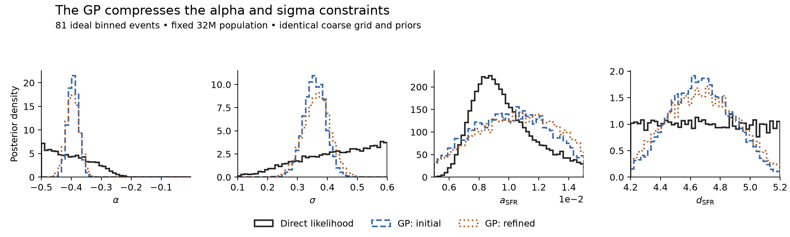

# First joint COMPAS posterior pilot

**Update:** a noise-freezing implementation bug caused much of the original GP
narrowing. See [the matched diagnosis and repair](GP_NOISE_DIAGNOSIS.md). The
results below are retained as historical experiments, not evidence that the
configured noise was actually fixed.

Configuration: `../grid_resolution/joint_pilot.toml`; fixed 32M population,
81-event perfect binned Poisson catalogue, 0.1 yr, `mass10` grid (870 pixels),
full prior and mass support, training seed 17. The other two training seeds have
not been run. No observed LVK data are used.

## Baseline result: reject the GP posterior

The first frozen pilot used 128 uniform initial evaluations and 128 active
evaluations, then four NUTS chains. It completed 356 direct evaluations including
100 held-out evaluations in 238.4 seconds. Training took 172.7 seconds. These
are measured local wall times excluding Python imports.

The sampler converged by the chosen diagnostics: maximum rank/folded split
R-hat 1.00124, minimum bulk ESS 8114, minimum tail ESS 3971, zero divergences.
These diagnostics do not establish that the GP posterior matches COMPAS.

Direct likelihood checks at 70 randomly selected GP posterior locations give:

| Diagnostic | Baseline |
| --- | ---: |
| Centred raw-lnL RMSE (constant offset removed) | 2.640 |
| Maximum absolute centred error | 9.454 |
| Importance-weight ESS, out of 70 | 2.03 |

The target was approximately 0.1 lnL RMS. This is a clear failure, so an
expensive direct-reference chain was deferred at that stage. Reweighting is inadequate
and must not be presented as a corrected or converged reference posterior.
The direct reference below now measures interval-width ratios for this catalogue.
Repeated-catalogue coverage remains untested.

The remaining held-out locations are 20 points expanded about the GP posterior
and 10 full-prior points. These provide exploratory broader checks, not proof
that no mode is missing. Both model and direct likelihood use the same finite
population, so this discrepancy isolates the surrogate approximation rather
than a 32M-versus-512M difference.

## Mechanism checks

The initial likelihood range exceeds 11,000. None of the 128 active evaluations
improved on the best initial value (-60.28469), and none of the first held-out
evaluations exceeded it either. Thus no observed better point was erased by the
initial transform ceiling in this experiment; blaming that mechanism would not
be supported. Failure to discover a better point is not proof that the initial
point was optimal.

The GP is locally inaccurate even in the region its own chains visit. The
bounded diagnostic below retained all 256 original points, promoted the 100 direct
validation evaluations to training, refitted the same GP and transform, and tested
on a fresh 100 points. The original held-out set is then training data, not
validation. This tests whether additional local information helps without
truncating the prior, dropping far-tail points or changing the kernel/grid.

## Bounded local refinement: also reject

The refinement used 356 training points and 100 fresh direct checks, including
70 from its newly sampled posterior. It took 72.1 seconds and retained every
original training point. The same GP optimization procedure was used; no grid,
prior, transform or GP configuration was changed.

| Diagnostic | Baseline | Local refinement |
| --- | ---: | ---: |
| Centred posterior-region lnL RMSE | 2.640 | 2.641 |
| Maximum absolute centred error | 9.454 | 9.979 |
| Diagnostic weight ESS /70 | 2.03 | 10.09 |
| Maximum R-hat | 1.00124 | 1.00174 |
| Divergences | 0 | 0 |

The likelihood-accuracy gate still fails decisively. Weight concentration improves
but does not establish a reliable corrected posterior. Both samplers pass their
diagnostics, illustrating why that alone is insufficient. Total new direct calls
across both runs: 456. Total measured work: 310.5 seconds, excluding imports/plots.

**Decision:** stop this configuration after the single permitted refinement. Do
not expand to the other seeds, more MCMC draws, more coarsening, or an expensive
direct chain merely to quantify an already obvious surrogate failure. The fixed
grid remains a candidate; the GP approximation is the failing component here.
This is not proof that every GP approach fails or a measurement of CI coverage.

The subsequent direct-reference experiment below implements analytic amplitude
marginalization and an exact reusable rate contraction. It now quantifies the
constraint distortion and provides a practical alternative for the next checks.

`results_seed17/refinement_comparison.png` compares fresh residuals from each
pilot. Numeric results and samples for the refinement are under
`results_seed17/local_refinement/`.

## Reproduction and outputs

From the repository root:

```bash
MPLCONFIGDIR=/tmp/compas-grid-matplotlib .venv/bin/python docs/studies/joint_pilot/run_pilot.py
MPLCONFIGDIR=/tmp/compas-grid-matplotlib .venv/bin/python docs/studies/joint_pilot/plot_pilot.py
MPLCONFIGDIR=/tmp/compas-grid-matplotlib .venv/bin/python docs/studies/joint_pilot/refine_pilot.py
```

`results_seed17/` contains a provenance manifest, append-only direct-evaluation
cache, training points, fitted GP/scaler, grouped and flattened posterior draws,
held-out points with raw direct/GP values, timing and summary JSON, and the
`heldout_diagnostics.png` figure. Generated output files are ignored by Git.
The baseline runner refuses to reuse results with changed provenance; start a
separate output directory for a different configuration. The refinement script
is a one-off diagnostic and rerunning it repeats its evaluations.

Figure contract: static scientific scatter of direct versus aligned GP lnL,
centred residuals versus alpha, and best-training-value trace. Blue points,
neutral identity/zero lines and orange ceiling; no approximate reweighted
corner plot labelled as truth. The exported figure has been visually inspected.

These two GP runs were the first rejection tests in S2. The following experiment
adds a direct reference; none establishes calibrated GP parameter constraints.

## Direct reference and next GP hypothesis (2026-09-08)

The direct reference now exists. `direct_reference.py` uses
`FixedPopulationRates` to precompute a sparse linear map from formation-redshift
and metallicity weights to detection bins. This retains the legacy delay lookup,
selection, population, cosmology, and all mass support. Only the four inference
parameters can vary; rebuild the map if other inputs change. Production defaults
and the existing integrator entry points remain unchanged.

At 23 full-prior/fiducial/boundary probes, maximum bin-rate discrepancy divided
by the largest rate was 6.27e-15; maximum log-likelihood discrepancy was 4.55e-13.
Median evaluations fell from 0.593 s to 0.00234 s (~253x). This is computational
reuse, with floating-point accumulation differences, not a fitted approximation.
It does not fix finite-population bias.

The independent uniform prior on SFR amplitude permits an analytic truncated
Gamma integral. Four dispersed adaptive random-walk Metropolis chains sample the
remaining three parameters. Covariance adaptation stops after 3000 warmup steps;
12000 retained draws per chain include conditional Gamma amplitude draws.
Maximum rank-normalized split R-hat is 1.00142, minimum bulk ESS 3185 and minimum
tail ESS 4322. An independent scrambled 8192-point full-prior Sobol integral has
weight ESS 2854 and shape-parameter means agree within 0.027 direct marginal SD.
This reduces missed-mode concerns but is not a mathematical proof of their absence.
Total runtime including setup, 23 legacy comparisons, chains and Sobol check was
98 s (first chain-only run: 77 s).

**The GP intervals really are too narrow relative to the same direct target.**

| Parameter | Initial GP / direct 68% width | Refined GP / direct 68% width |
|---|---:|---:|
| alpha | 0.235 | 0.283 |
| sigma | 0.271 | 0.336 |
| SFR a | 1.286 | 1.327 |
| SFR d | 0.642 | 0.723 |



This is one 81-event mock from the same finite 32M population, with perfect binned
observations. It establishes surrogate distortion, not repeated-catalogue coverage,
population convergence, or suitability for LVK data. In particular, SFR d is
nearly unconstrained by this catalogue over the chosen prior.

A bounded next hypothesis (`reduced_gp_probe.py`) learns the **3D
amplitude-marginalized likelihood**, retaining all 456 old projected locations
and adding 128 reference-posterior locations plus a directly optimized point.
With the same Matérn-5/2 sqrt-transform family and full prior, 585 training points
produce centered RMS **0.785 lnL**, maximum centered error 3.196, at 256 held-out
reference-posterior locations (6.24 s). This still fails the ~0.1 target. Its score
is not strictly paired with the previous 4D score: both the target and validation
locations changed. No reduced-GP posterior or calibration claim follows.
Training used the direct reference, so the experiment is diagnostic and its cost
must include obtaining that reference in any end-to-end comparison.

Reproduce from the repository root:

```bash
MPLCONFIGDIR=/tmp/compas-grid-matplotlib .venv/bin/python docs/studies/joint_pilot/direct_reference.py
MPLCONFIGDIR=/tmp/compas-grid-matplotlib .venv/bin/python docs/studies/joint_pilot/plot_reference.py
MPLCONFIGDIR=/tmp/compas-grid-matplotlib .venv/bin/python docs/studies/joint_pilot/reduced_gp_probe.py
```

Outputs contain chains, numeric comparison, validation arrays and direct-run
provenance. Scripts overwrite their named experimental output directories when
rerun. Next priority: finite-population checks with this fast direct target,
starting with 512M provenance and memory estimates. Additional GP tuning is
secondary until it offers a measured benefit over the accelerated direct method.


Latest follow-up: [repaired reduced GP validation](REDUCED_GP_VALIDATION.md) records three fresh training seeds, 512M transfer and the completed 20-catalogue pilot. Earlier failed experiments remain historical evidence.


Completed follow-up: [100-catalogue frozen-procedure ensemble](CALIBRATION_100.md), including refined direct references. All 100 interval comparisons pass; actual LVK work is outside this paper.


Latest experiment: [BO acquisition and GP uncertainty KL curves](BO_UNCERTAINTY.md). Grid frozen; three catalogues and three seeds completed.


Completed [BO versus Sobol acquisition comparison](ACQUISITION_COMPARISON.md); grid and production settings unchanged.


User-directed follow-up: [posterior-focused label efficiency](LABEL_EFFICIENCY.md) improves the tested all-trajectory passing budget from 610 to 482. The earlier conclusion remains specific to the EI/variance policy. [Riley–Mandel comparison protocol](RILEY_MANDEL_COMPARISON_PLAN.md) distinguishes rate emulation from catalogue-specific lnL emulation.
