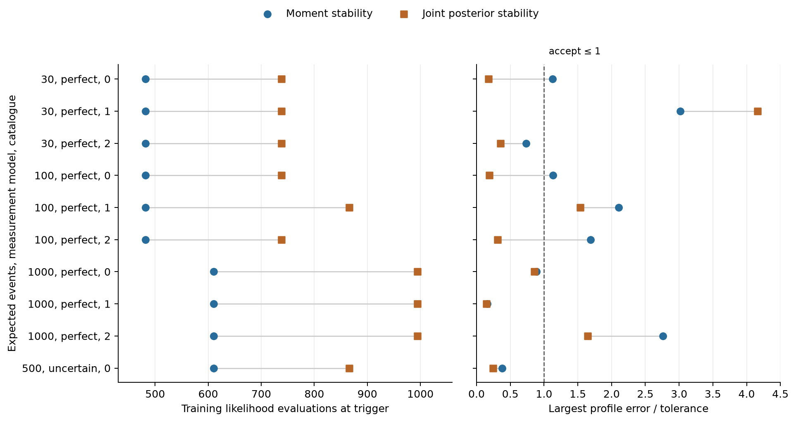

# COMPAS GP-LnL stopping: checkpoint experiments

**Prefer posterior stability as the stopping trigger. Use fresh likelihood
checks to test accuracy; do not require the local GP Hessian to converge.**
This ten-catalogue screen supports that design choice, but does not establish
a production stopping rule or a general failure probability.

## Tested rules and results

All decisions use training labels, successive GP fits, or small fresh audits.
No reference GP or dense exact LnL grid is used by a decision. Existing exact
references are revealed only for offline scoring. The first experiment is
checkpoint replay; the later audit is explicitly a development follow-up on
the same catalogues after seeing the first results.

| Candidate | Accurate selections | Premature selections | No acceptance on saved path |
|---|---:|---:|---:|
| Two entirely correct batches of new-label predictions | 0 | 0 | 10 |
| Prediction batches plus moment stability | 0 | 0 | 10 |
| Gaussian moment stability | 10 | 0 | 0 |
| Joint posterior stability | 10 | 0 | 0 |
| Moment stability + local derivative audit | 0 | 0 | 10 |
| Moment stability + profile/mode audit | 4 | 0 | 6 |
| Joint stability + local derivative audit, follow-up | 1 | 0 | 9 |
| Joint stability + profile/mode audit, follow-up | 7 | 0 | 3 |

The prediction rule borrows GPry's error scaling, but requiring two complete
128-label batches to pass is substantially stricter than GPry's consecutive
correct-prediction counter. Its rejection rate does **not** evaluate the actual
GPry implementation. The moment rule uses both directed Gaussian KLs <0.02 on
two successive updates. [GPry convergence documentation](https://gpry.readthedocs.io/en/latest/module_convergence.html).

Joint stability requires both directed joint KLs <0.001, changes in means and
68%/95% endpoints <0.05 posterior SD, and changes in 68% widths <3%, twice. Two
independently scrambled GP-only importance designs must resolve those same
summary tolerances and have ESS ≥100. Their proposal includes the full uniform
prior and a broad Student-t component; proposal refinement never changes the prior.

Joint stability selected 738–994 training labels. Its maximum directed
GP-versus-direct posterior KL ranged from 0.000078 to 0.001045.
Offline accuracy additionally requires mean/endpoint shifts <0.2 SD, 68% and
95% width errors <10%, both KLs <0.01, and resolved reference integration.
The earlier moment trigger selected 482–610 labels; all ten already passed
these offline accuracy criteria. This cannot establish that moment stability
alone is safe outside these paths.

## Fresh likelihood checks and JAX

The profile audit evaluates the GP posterior mean, an autodiff-optimized GP
maximum, and ±1/±2 posterior-SD positions along three covariance directions.
These **14 locations** compare exact-minus-GP residuals relative to the centre,
so a constant LnL offset cancels. The tolerance is 0.1 + 0.01 times the LnL drop
from the best audit point. Directions reaching a prior boundary stop just inside it.

For this matched experiment, each audit also evaluated a two-resolution full
gradient/mixed-Hessian stencil: **50 exact likelihood calls per checkpoint**,
500 in each experiment, 1000 in total. The table and figure show training counts;
add 50 for the actual audit cost. A standalone profile implementation would add
14. These counts are likelihood labels, not a measured end-to-end speedup.

JAX differentiates the inverse-transformed GP mean, caching the GP solve once
per fit. Gradients drive bounded multistart L-BFGS-B mode finding. Curvature
and score differences are measured in posterior SD units. The exact evaluator
used here is `ratesSampler/fixed_population.py`, which is NumPy/SciPy; exact
derivatives are therefore assessed by matched finite differences. The adjacent
COMPAS GPU implementation uses NumPy/CuPy, not JAX. A separate JAX rate evaluator,
if available elsewhere, would allow an exact-score check, provided the complete
likelihood (including amplitude marginalization) also supports differentiation.

The local stencil residuals can be only ~0.01–0.05 LnL while local curvature
and its finite-difference refinement fail. Accurate integrated posteriors do
not require every local second derivative to meet the chosen threshold.
The derivative screen is therefore too restrictive here. This is not a failure
of JAX autodiff: cached GP means/gradients match the existing target, and its
autodiff Hessian passes an independent numerical derivative unit test.



Each row is one COMPAS catalogue. Blue circles are the first moment-stability
trigger; orange squares are the first joint-stability trigger. The right panel
uses the identical audit tolerance at each checkpoint; values ≤1 pass. Waiting
for joint stability increases profile acceptance from 4/10 to 7/10. The three
remaining rejections are at posteriors that pass the stated offline accuracy
criterion: this audit remains conservative for that criterion.

| Expected events, measurements, case | Moment trigger | Joint trigger | Early profile error/tolerance | Later profile error/tolerance | Later reference KL |
|---|---:|---:|---:|---:|---:|
| 30, perfect, 0 | 482 | 738 | 1.13 | 0.18 | 0.00008 |
| 30, perfect, 1 | 482 | 738 | 3.02 | 4.16 | 0.00105 |
| 30, perfect, 2 | 482 | 738 | 0.74 | 0.35 | 0.00039 |
| 100, perfect, 0 | 482 | 738 | 1.13 | 0.19 | 0.00033 |
| 100, perfect, 1 | 482 | 866 | 2.11 | 1.53 | 0.00031 |
| 100, perfect, 2 | 482 | 738 | 1.69 | 0.31 | 0.00020 |
| 1000, perfect, 0 | 610 | 994 | 0.89 | 0.86 | 0.00050 |
| 1000, perfect, 1 | 610 | 994 | 0.16 | 0.15 | 0.00019 |
| 1000, perfect, 2 | 610 | 994 | 2.76 | 1.65 | 0.00034 |
| 500, uncertain, 0 | 610 | 866 | 0.38 | 0.24 | 0.00074 |

## Practical rule to take forward

1. Train with the existing full prior and all training labels. At checkpoints,
   require two consecutive numerically resolved joint-posterior stability passes.
2. Use JAX gradients to locate candidate GP maxima; evaluate the small fresh
   profile/mode audit before accepting the surrogate.
3. On audit failure, use the offending locations to guide more exact evaluations
   and refitting, then repeat with fresh audit points. Keep a resource cap and
   return an unresolved status if the tests do not pass.

Steps 1 and 2 were screened here. Step 3's adaptive continuation was **not**
executed in these checkpoint experiments. A posterior-weighted audit may reduce
unnecessary rejection relative to the maximum-error profile rule, but that is
a separate candidate to validate on COMPAS. Preserve broad acquisition because
these local checks do not measure whether an unvisited region has posterior mass.

The ten paths share the source BO training seed and fixed population/injection:
three catalogues each at expected counts 30, 100, 1000 with perfect measurements,
plus one independent pilot catalogue at count 500 with uncertain measurements.
They are three-parameter shape posteriors with analytically marginalized
amplitude, a fixed 256M COMPAS population, and the existing detected-rate grid.
The uncertain pilot is not an independent uncertainty ensemble. Source paths
were truncated by a reference-assisted stopping campaign, so non-acceptance is
censored. This tests surrogate accuracy conditional on that setup; it does not
test finite-population stability, real-data calibration, evidence accuracy, or
rare stopping failures.

## Reproduction and verification

From the repository root, use the existing `.venv` with
`OPENBLAS_NUM_THREADS=1 OMP_NUM_THREADS=1 MPLCONFIGDIR=/tmp/compas-mpl`:

```bash
.venv/bin/python docs/studies/operational_stopping/compas_geometry/run_study.py --outdir NEW_SCREEN_DIRECTORY
.venv/bin/python docs/studies/operational_stopping/compas_geometry/audit_later.py --input NEW_SCREEN_DIRECTORY --outdir NEW_AUDIT_DIRECTORY
.venv/bin/python docs/studies/operational_stopping/compas_geometry/publish_results.py
```

The report builder reads the archived `compas_v1` and `later_audit_v1` folders.
Original COMPAS block caches and source checkpoint/catalogue files must be
available; source locations and source snapshots are preserved in the manifests.
`comparison.json` contains chart/table data. Decisions were hashed before offline
scoring and their hashes are verified by the report builder. The source protocol
and [follow-up protocol](FOLLOWUP_PROTOCOL.md) record design adjustments.

Software validation: 109 fast tests passed, 3 heavy tests deselected, including
four new local-geometry tests. This verifies implementation, not statistical
reliability. No production stopping defaults or rate physics were changed.
