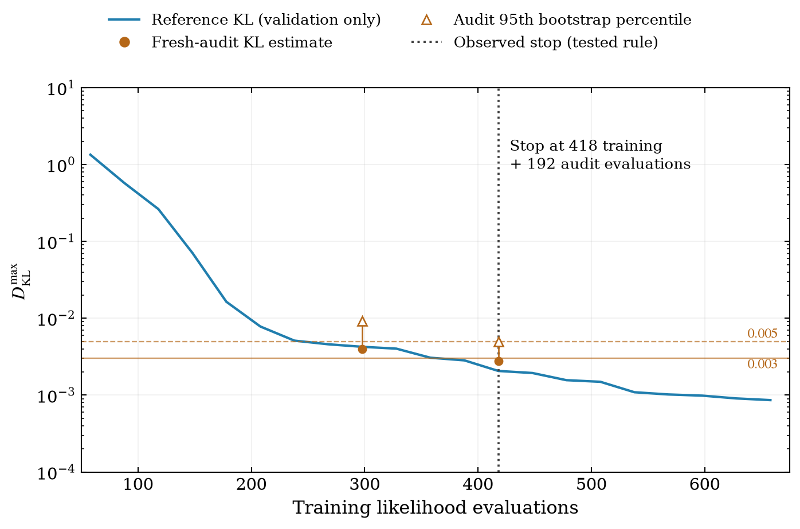
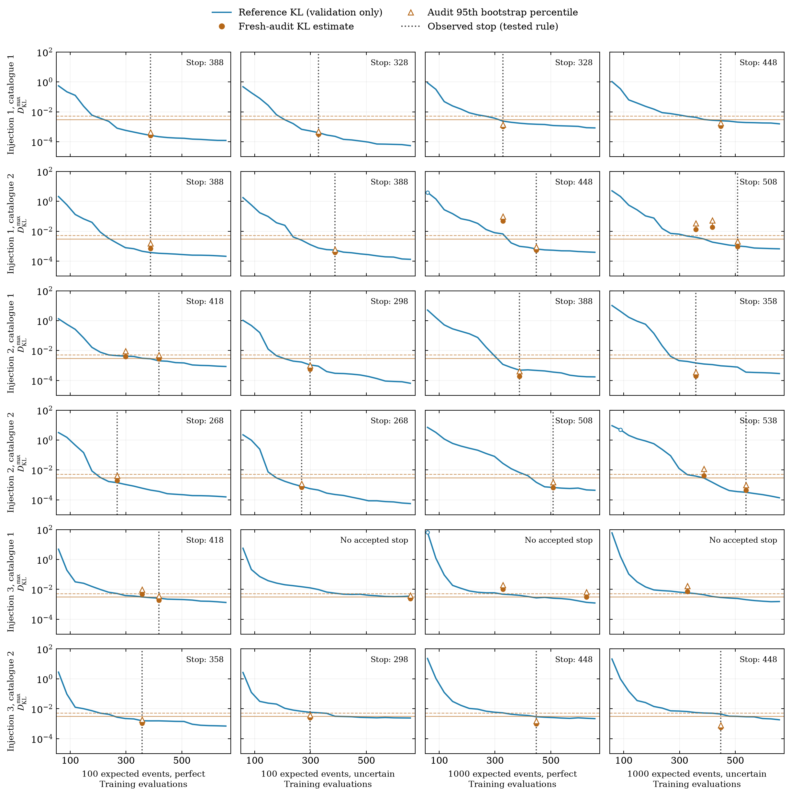
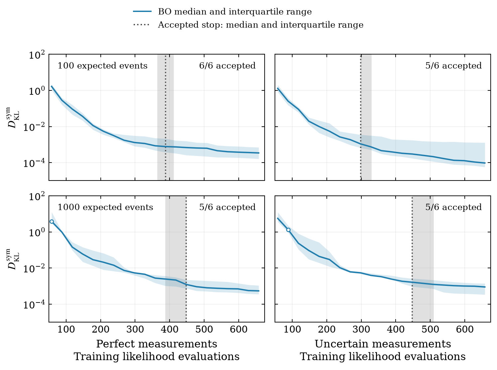

# Stopping diagnostics for the COMPAS surrogate

The proposed explanation is: **Stop when fresh likelihood checks show that
correcting the surrogate would barely change the posterior.** The figures below
show measurements and stopping decisions from the existing, more restrictive
combined rule. The periodic/adaptive-size audit revision has not been run.

## Audit overlaid on KL



Illustrative confirmation case `t1_n100_perfect_c0_bo`: injection 2,
100 expected events, perfect measurements, catalogue
1. Blue is the reference discrepancy, computed only for validation.
Orange circles are estimates from fresh 96-point likelihood audits; open triangles
are the 95th percentiles of 256 stratified bootstrap resamples. Vertical orange
segments link the two statistics, not confidence intervals. The horizontal solid
and dashed orange lines are their respective acceptance thresholds, 0.003 and
0.005. The black dotted line is the recorded stop at 418 training
plus 192 audit evaluations (610 total).

Both reference and audit use the larger of the two directed KL divergences,
`D_max = max(KL(p || q), KL(q || p))`, rather than symmetric KL, to match the audit
criterion. The reference curve conservatively takes the largest value across
the two independent numerical integrations as well. The audit approximates the
discrepancy by importance weighting fresh exact likelihood evaluations against
the GP: `w_i proportional to exp(lnL_exact_i - lnL_GP_i)`, with the actual mixture
proposal accounted for. An additive constant cancels on normalization.

The tested rule also required the prediction counter, posterior stability,
pointwise residual and effective-sample-size checks. Crossing the orange lines
alone is therefore **not** a reconstruction of its stopping decision. Bootstrap
percentiles describe finite-audit variability; they are not guaranteed bounds on
the full posterior discrepancy or sequential confidence guarantees. The 4D
physical posterior uses a 3-input GP with an exact shared amplitude conditional.
The example is selected using audit history and stop count, not reference KL.

## All cases



Rows: injections 1–3, two catalogues per injection. Columns: 100/perfect,
100/uncertain, 1000/perfect, 1000/uncertain. Identical encodings, scales and
thresholds are used throughout. Three cases have no accepted stop by 658 training
evaluations. Missing orange markers mean no audit was performed, not a passed or
failed audit. Hollow blue circles retain numerically unresolved reference/GP
integrations. All runs continued to 658 training points for validation, even after
their recorded stop; audit points were held out of training in this experiment.

## Ensemble stopping locations



Blue is median symmetric KL, half the sum of directed KLs, with its interquartile
range across all six cases per panel. Grey bands and dotted lines show the
interquartile range and median of **accepted** training stopping locations.
Non-stopping cases remain in the blue curves and are excluded only from those
conditional stop summaries; accepted counts are shown. Grey shading is variation
in stopping location, not an error threshold. Hollow blue circles mark a
checkpoint with at least one unresolved numerical integration. The horizontal
axis excludes audit cost; the single-case caption reports total cost explicitly.
Top/bottom rows use 100/1000 expected events; left/right use perfect/uncertain
measurements. The first injection was used for rule development.

## Reproduce

From the repository root:

```sh
MPLCONFIGDIR=/tmp/compas-mpl .venv/bin/python docs/studies/operational_stopping/gpry_compas/plot_audit_stopping.py --input docs/studies/operational_stopping/gpry_compas/extension_v2 --outdir docs/studies/operational_stopping/gpry_compas/audit_plot_draft
```

Only saved rates/likelihood results and audit records are used. No new likelihood
calls, GP training, reference integration or changes to frozen decisions occur.
`plot_data.json` contains every plotted value; `provenance.json` identifies source
hashes and records the numerical reconstruction of all 31 audit results.
