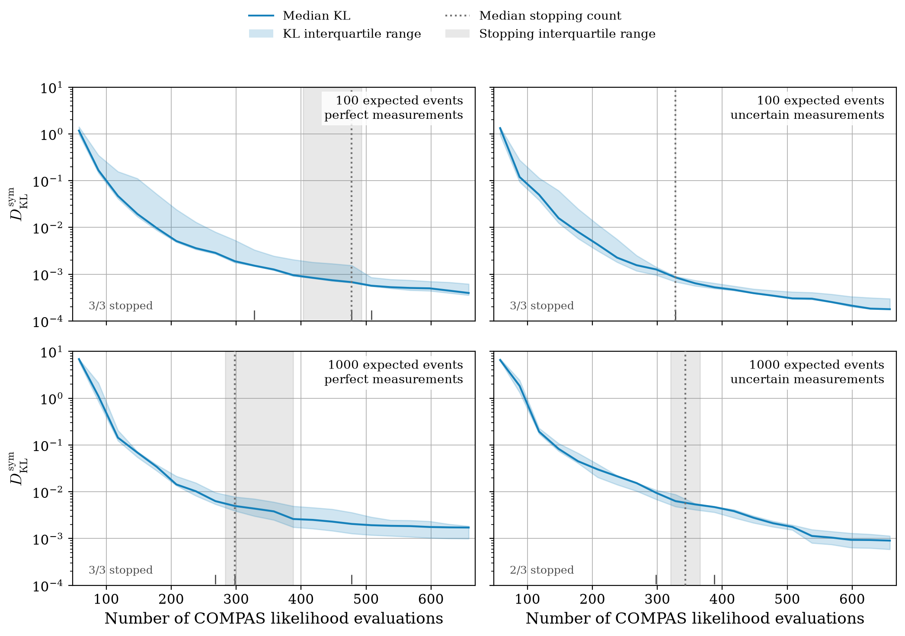
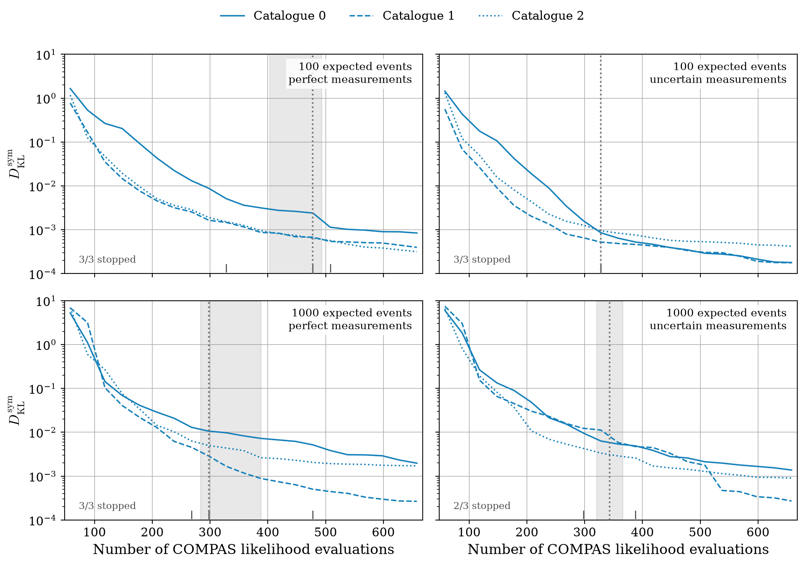

# GPry-style stopping on the COMPAS LnL surrogate

Implemented in the existing JAX/GPJax environment without installing or vendoring
GPry. Twelve new BO trajectories cover three fresh paired catalogue/BO-seed
realisations at each combination of expected count 100/1000 and perfect/uncertain
measurements. Three stopping criteria are monitored on every shared trajectory.

**Counter plus Gaussian KL is the most useful candidate in this experiment.**
It reduced premature stopping from four cases to one, with a median stopping
count of 328 likelihood labels. One further run did not resolve the GP-only
integration check. The joint-stability comparator had the same overall outcome
counts and a median of 358 labels; its premature case was a different catalogue.
This twelve-run result is not a guarantee that the rule meets our strict accuracy
criterion on a new problem, so it has not been enabled as a production default.

| Candidate | Accurate stops | Premature stops | Numerically unresolved stops | No stop by budget | Median labels at stop |
|---|---:|---:|---:|---:|---:|
| Four-correct counter | 8 | 4 | 0 | 0 | 268.0 |
| Counter + Gaussian KL | 10 | 1 | 0 | 1 | 328.0 |
| Joint posterior stability | 10 | 1 | 0 | 1 | 358.0 |

Medians include only runs that stopped. Accuracy requires independent numerical
agreement, both directed KLs <.01, mean and interval-endpoint errors <.2 SD, and
68%/95% width errors <10%. No stop is counted as success merely because its
own convergence monitor passed.

Every combined-rule stop had symmetric KL at most 0.00954. The one
classified as premature failed the stricter requirement that **each direction**
be below 0.01: its maximum directed KL was 0.01293. Its largest
interval-endpoint discrepancy was 0.10 posterior SD, and its 95% width error was
below 2.6%. The four-correct rule alone also had a clearer failure, with symmetric
KL 0.066 and an interval-endpoint discrepancy of 0.30 SD. These distinctions
matter when interpreting the curves and the binary accuracy table.

A separate final-checkpoint diagnostic doubled the GP-only integration
design from 16384 to 32768 base points per replicate. The unresolved uncertain,
count 1000 case then passed numerical precision, with **zero extra COMPAS
likelihood calls**. Its original stopping decision and the plots are unchanged.
This diagnoses unnecessary continuation caused by numerical error; it does not
retroactively establish an earlier online stop. Refine GP-only integration
before spending more exact evaluations when the numerical check fails.
See [the diagnostic](../precision_diagnostic.json) and
[its script](../check_precision.py).


## Convergence plots



Blue lines show the median symmetric KL to direct COMPAS posterior estimates;
blue shading is the interquartile range across three runs per panel. Grey
shading and the dotted line show the interquartile range and median stopping
count for the counter-plus-Gaussian-KL rule. Bottom ticks show individual stops.
The number stopped is printed in every panel; censored runs are never assigned
a stopping count. Bands are descriptive between-run spread, not confidence
intervals. Perfect/uncertain panels share the underlying mock catalogues.

All curves continue to 658 labels. Decisions are frozen when the candidate
first passes; subsequent labels are validation continuation. The common plotted
grid is every 30 labels beginning at 58. Extra saved checkpoints score stops that
occur between those plotting points. There is no smoothing, monotonic envelope,
interpolation between different run lengths, or replacement of direct truth by
a larger GP. Symmetric KL is half the sum of the two directed KLs, as in the
paper; stopping stability uses the documented maximum-directed convention.

Other stopping overlays: [four-correct counter](convergence_correct_counter.png),
[joint posterior stability](convergence_joint_stability.png).
Vector exports: [preferred-rule PDF](convergence_counter_and_gaussian.pdf),
[counter PDF](convergence_correct_counter.pdf), [joint-stability PDF](convergence_joint_stability.pdf).

Individual example-format panels: [100 perfect](n100_perfect.png),
[100 uncertain](n100_uncertain.png), [1000 perfect](n1000_perfect.png),
[1000 uncertain](n1000_uncertain.png). Each also has a same-named PDF.



The companion displays all three trajectories in each regime. Catalogue labels
0/1/2 correspond to BO seeds 5011/5012/5013. These fresh catalogues are all generated
at the same fixed physical injection. Three repetitions do not establish a
rare-failure probability or simulation-based calibration.

## What was borrowed and what was adapted

The [GPry paper](https://arxiv.org/html/2211.02045v2) supplies the posterior-weighted
uncertainty acquisition, small Kriging-believer batches, and Eq. 16 prediction
counter. The [current documentation](https://gpry.readthedocs.io/en/latest/module_convergence.html)
also supports combining a prediction check with Gaussian posterior stability.
The experiment follows the paper's prediction-based relative tolerance, rather
than the actual-label form in current documentation.

For our three-dimensional shape inference, epsilon_abs=.0352674038,
epsilon_rel=.01, and four consecutive correct labels are required. Predictions
and the best-known LnL are saved before the whole batch is evaluated. A later
failure within a batch resets an earlier successful streak. The combined rule
requires the counter still to pass at a 30-label checkpoint, alongside two
Gaussian KL<.02 passes. The third rule requires two joint KL<.001 passes plus
stable moments and intervals, on the same checkpoint schedule.

This is a COMPAS adaptation, not a run of the GPry package. The existing
Matérn-5/2 kernel, sqrt compression, all training points, full prior and analytic
amplitude marginalization are retained. No SVM is used. GP hyperparameters and
scaling are refitted every 30 labels; every three-label batch is conditioned
exactly between refits. JAX gradients optimize acquisition from multiple starts.
The nonlinear sqrt inverse's predictive uncertainty is propagated through its
second/fourth moments; it is not treated as a linearly rescaled Gaussian in LnL.
Uncertainty guides acquisition and is not assumed calibrated by a passing counter.

Fixed-capacity arrays remove compilation triggered solely by growth in the
training-array shape. Numerical tests compare cached means/variances and
Kriging-believer conditioning with GPJax, compare the transformed uncertainty
with numerical integration, and compare acquisition autodiff with finite
differences. The capacity slots are algebraically inactive padding, not data
subsetting. The rate evaluator and its physical model are unchanged.

## Exact stop counts and exceptional outcomes

| Run | Counter | Counter + Gaussian KL | Joint stability |
|---|---:|---:|---:|
| n100_perfect_case0 | 337 | 478 | 388 |
| n100_perfect_case1 | 247 | 328 | 268 |
| n100_perfect_case2 | 304 | 508 | 358 |
| n100_uncertain_case0 | 301 | 328 | 358 |
| n100_uncertain_case1 | 229 | 328 | 238 |
| n100_uncertain_case2 | 262 | 328 | 298 |
| n1000_perfect_case0 | 334 | 478 | 328 |
| n1000_perfect_case1 | 205 | 268 | 358 |
| n1000_perfect_case2 | 274 | 298 | 328 |
| n1000_uncertain_case0 | 298 | 298 | 388 |
| n1000_uncertain_case1 | 154 | 388 | 418 |
| n1000_uncertain_case2 | 244 | None | None |

`None` denotes no acceptance by the finite evaluation budget.

- n1000_perfect_case0, Four-correct counter: premature at 334 labels; symmetric KL 0.0097072.
- n1000_perfect_case0, Joint posterior stability: premature at 328 labels; symmetric KL 0.0097423.
- n1000_perfect_case1, Four-correct counter: premature at 205 labels; symmetric KL 0.015817.
- n1000_uncertain_case0, Four-correct counter: premature at 298 labels; symmetric KL 0.0095402.
- n1000_uncertain_case0, Counter + Gaussian KL: premature at 298 labels; symmetric KL 0.0095402.
- n1000_uncertain_case1, Four-correct counter: premature at 154 labels; symmetric KL 0.065628.
- n1000_uncertain_case2, Counter + Gaussian KL: budget_limit.
- n1000_uncertain_case2, Joint posterior stability: budget_limit.

## Evidence and reproducibility

The experiment used 7896 training/continuation likelihood labels. The sum of
per-run measured wall times was 573.8s; separate offline scoring took
80.6s. Population setup and catalogue generation are
additional. These figures are not an end-to-end speedup comparison. Earlier
studies used different initial designs and refit schedules, so their label
counts are not a matched acquisition baseline for this experiment.

The expensive reference-rate arrays already existed. A separate scoring process
read them only after all decisions were saved, then formed each new catalogue's
direct likelihood and posterior weights. Two independently scrambled importance
designs assess numerical precision. There were 0 numerically
unresolved checkpoint scores out of 263; plotted curves are numerical
estimates, and unresolved stop scores are explicitly excluded from successes.

The [frozen protocol](../PROTOCOL.md) specifies the experiment. In the input
directory, `manifest.json` and `population/source_snapshot` capture configuration
and source, `batches.json` saves pre-training predictions and exact labels,
`checkpoint_*.npz` saves each scored GP, and `offline/` contains reference hashes,
scores and decision-hash verification. `plot_data.json` supplies every plotted
curve. The failed first smoke and corrected small smoke are preserved and excluded.

The original v1 implementation passed all 119 fast tests (3 heavy tests
deselected). A separate prefix replay verified all 2400
batches, 263 checkpoint hashes and all stopping
decisions. It reconstructed 753
pre-training predictions, with maximum discrepancy
7.73e-12 LnL. Twelve spot
checks of the cached reference rates matched the online COMPAS rate evaluator
exactly. The input directory's `verification.json` and offline manifest contain
the machine-readable evidence.

From the repository root, with the existing `.venv`, set
`OPENBLAS_NUM_THREADS=1 OMP_NUM_THREADS=1 MPLCONFIGDIR=/tmp/compas-mpl` and run:

```bash
.venv/bin/python docs/studies/operational_stopping/gpry_compas/run_experiment.py --outdir NEW_RUN_DIRECTORY
.venv/bin/python docs/studies/operational_stopping/gpry_compas/score_experiment.py --input NEW_RUN_DIRECTORY
.venv/bin/python docs/studies/operational_stopping/gpry_compas/verify_experiment.py --input NEW_RUN_DIRECTORY
.venv/bin/python docs/studies/operational_stopping/gpry_compas/publish_results.py --input NEW_RUN_DIRECTORY --outdir NEW_REPORT_DIRECTORY
```

No GPry installation is needed. The source COMPAS block caches and existing
reference-rate arrays are required to reproduce this benchmark. The online
learner itself does not load reference arrays. Production stopping defaults
remain unchanged pending assessment of these results.
