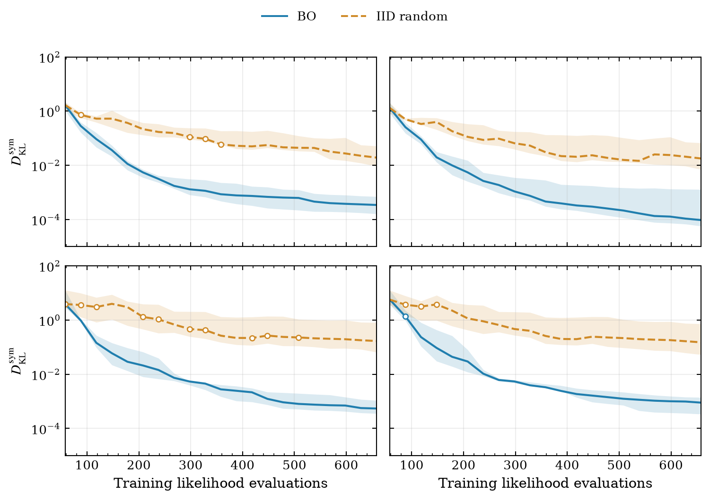
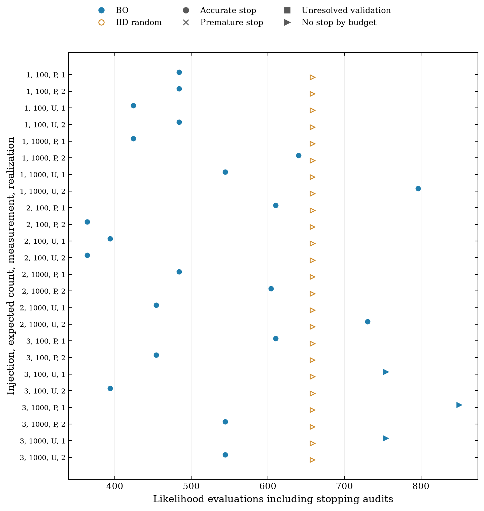
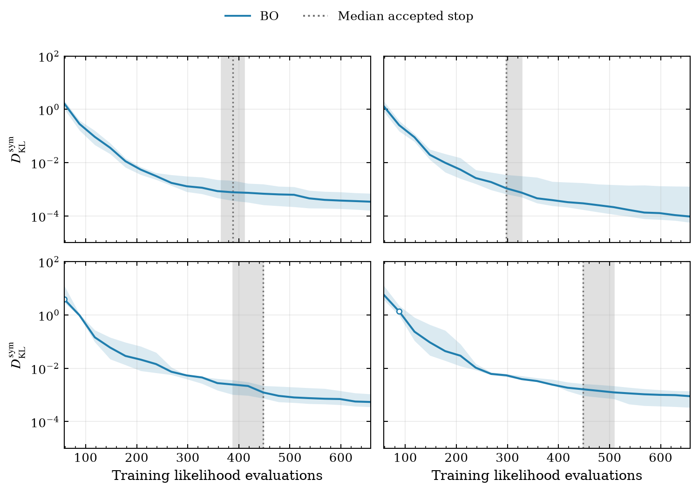

# COMPAS stopping extension: BO versus IID random

Three injections, two expected counts, and two independent latent catalogues per combination give 12 fresh latent catalogues. Perfect/uncertain views yield 24 likelihood cases and 48 trajectories. This is a held-out extension of the previous stopping study, not evidence for every COMPAS case.



Top row: 100 expected events; bottom: 1000. Left: perfect measurements; right: uncertain. Blue solid is BO; orange dashed is IID uniform random continuation after identical initialization. Curves show median symmetric KL (half the sum of directed KLs), with descriptive interquartile bands across six cases per panel. All runs continue to 658 training labels. No curves are smoothed. Hollow markers indicate that at least one contributing case has unresolved numerical integration; those early estimates are retained rather than silently excluding the case. Audits are separate exact evaluations and are excluded from this training-budget axis.

| Method | Rule | Accurate | Premature | Unresolved | No stop | Median training | Median total |
|---|---|---:|---:|---:|---:|---:|---:|
| BO | Counter + Gaussian KL | 21 | 1 | 0 | 2 | 328 | 328 |
| BO | Precision-refined counter + Gaussian KL | 22 | 2 | 0 | 0 | 328 | 328 |
| BO | Pointwise audit | 15 | 0 | 0 | 9 | 418 | 640 |
| BO | Posterior-mass audit | 21 | 0 | 0 | 3 | 388 | 484 |
| RANDOM | Counter + Gaussian KL | 0 | 3 | 0 | 21 | 448 | 448 |
| RANDOM | Precision-refined counter + Gaussian KL | 0 | 4 | 0 | 20 | 448 | 448 |
| RANDOM | Pointwise audit | 0 | 0 | 0 | 24 | -- | -- |
| RANDOM | Posterior-mass audit | 0 | 0 | 0 | 24 | -- | -- |

The posterior-mass variant was defined after inspecting pointwise tail-audit failures at the first injection, before revealing reference scores. Injection 1 is development evidence for this variant. Its independent confirmation uses injections 2/3 (16 likelihood cases per method).

- BO mass-audit confirmation: 13 accurate, 0 premature, 0 unresolved, 3 no stop; median total among stops 484.
- RANDOM mass-audit confirmation: 0 accurate, 0 premature, 0 unresolved, 16 no stop; no accepted stops.

Stopping medians include accepted runs only, including any premature/unresolved acceptances. They exclude censored runs and are not paired speedup estimates. All four marginal intervals are checked at every claimed stop and final fit. Accuracy also requires each directed KL <0.01 and independent numerical resolution. The plotted symmetric KL being <0.01 is insufficient by itself.

The counter assesses the points selected by each acquisition method. Random sampling can therefore fail its counter through tail prediction errors even when its posterior is adequate. Its non-stops characterize this shared operational rule; the matched-budget accuracy curves are the primary acquisition comparison.

Cases reaching a posterior-mass audit: BO 24/24, RANDOM 0/24. A case that never reaches audit eligibility does not test the audit acceptance thresholds.

At injection 3, 100 expected events and uncertain measurements, one confirmation case never satisfies the original rule. Precision refinement plus the mass audit accepts after 298 training and 96 audit evaluations (394 total). Independent validation passes all four marginal checks, with maximum directed KL 0.00577.

The mass-audit rule does not dominate the pointwise audit case by case: 1 BO confirmation case accepted by the pointwise rule remains non-stopping with the independent mass-audit draws. The aggregate comparison retains this tradeoff.

At 658 training labels, full accuracy passes: BO 24/24; random 5/24. BO has lower final symmetric KL in 24/24 numerically resolved pairs (out of 24 pairs); the median paired random/BO KL ratio is 108.



Each row is a matched likelihood case under the posterior-mass stopping variant. P/U denote perfect/uncertain measurements; injections 1/2/3 follow the frozen protocol order. Filled/open markers distinguish BO/random. Circles indicate accurate acceptance, crosses premature acceptance, right-pointing triangles no stop by the actual budget spent. Each audit costs 96 exact calls; failed audits are included. Training continues independently of held-out audits, preserving the pure BO/random allocation comparison.

## Grid-free use and scope

Training, acquisition, GP-only stability and stopping audits require no parameter-space rate grid. They request exact rates only at selected coordinates. Cached exact rates and direct posterior integrations are used only after stopping decisions are frozen to score this tractable benchmark. The fixed mass/redshift output bins are a different grid and remain part of the likelihood.

The physical model has four parameters, but the GP has three inputs because amplitude is integrated analytically. With the same exact amplitude conditional, full-joint KL equals shape KL. Four marginal means and intervals are checked explicitly. Grid-free amplitude reconstruction still requires total rates at posterior points, which are additional to training/audit counts. No explicit four-input GP, new COMPAS evolutionary model, universal convergence guarantee, continuous-sensor calibration, or end-to-end runtime improvement is established.

The development case `t0_n1000_perfect_c0_bo` illustrates why a pointwise tail veto can be too conservative: it never accepted by the resource limit, whereas the posterior-mass rule accepted at 328 training plus 96 audit calls. Independent scoring gives maximum directed KL 0.00240 and passes all four marginal checks. This example motivated interpretation of the audit behavior; it is not counted in the mass-audit confirmation set.

## BO convergence with stopping markers



Panel order and blue median/interquartile KL curves match the acquisition comparison. The dotted vertical line and grey band show the median and interquartile range of accepted posterior-mass stopping checkpoints, conditional on stopping. They count training labels only; audit costs appear in the table and cost plot. Non-stopping runs remain in the blue curves and are excluded only from the conditional stopping quantiles. This plot includes the development injection. Accepted/total cases in panel order: 6/6, 5/6, 5/6, 5/6.

## Reproduction

Run from the repository root with the existing virtual environment:

```sh
OPENBLAS_NUM_THREADS=1 OMP_NUM_THREADS=1 MPLCONFIGDIR=/tmp/compas-mpl .venv/bin/python docs/studies/operational_stopping/gpry_compas/compare_random.py --outdir docs/studies/operational_stopping/gpry_compas/extension_v2
OPENBLAS_NUM_THREADS=1 OMP_NUM_THREADS=1 MPLCONFIGDIR=/tmp/compas-mpl .venv/bin/python docs/studies/operational_stopping/gpry_compas/run_mass_audit.py --input docs/studies/operational_stopping/gpry_compas/extension_v2
OPENBLAS_NUM_THREADS=1 OMP_NUM_THREADS=1 MPLCONFIGDIR=/tmp/compas-mpl .venv/bin/python docs/studies/operational_stopping/gpry_compas/score_comparison.py --input docs/studies/operational_stopping/gpry_compas/extension_v2
OPENBLAS_NUM_THREADS=1 OMP_NUM_THREADS=1 MPLCONFIGDIR=/tmp/compas-mpl .venv/bin/python docs/studies/operational_stopping/gpry_compas/verify_comparison.py --input docs/studies/operational_stopping/gpry_compas/extension_v2
OPENBLAS_NUM_THREADS=1 OMP_NUM_THREADS=1 MPLCONFIGDIR=/tmp/compas-mpl .venv/bin/python docs/studies/operational_stopping/gpry_compas/publish_comparison.py --input docs/studies/operational_stopping/gpry_compas/extension_v2 --outdir docs/studies/operational_stopping/gpry_compas/report_v2
```

[Frozen protocol](../EXTENSION_PROTOCOL.md); [all trajectories](all_trajectories.pdf).

[Mass-audit protocol](../MASS_AUDIT_PROTOCOL.md). Use a fresh output directory for a rerun.

## Exceptional outcomes

- t0_n100_perfect_c0_random, Counter + Gaussian KL: no_stop; None.
- t0_n100_perfect_c0_random, Precision-refined counter + Gaussian KL: no_stop; None.
- t0_n100_perfect_c0_random, Pointwise audit: no_stop; None.
- t0_n100_perfect_c0_random, Posterior-mass audit: no_stop; None.
- t0_n100_perfect_c1_random, Counter + Gaussian KL: premature; {'training': 448, 'audit': 0, 'total': 448}.
- t0_n100_perfect_c1_random, Precision-refined counter + Gaussian KL: premature; {'training': 448, 'audit': 0, 'total': 448}.
- t0_n100_perfect_c1_random, Pointwise audit: no_stop; None.
- t0_n100_perfect_c1_random, Posterior-mass audit: no_stop; None.
- t0_n100_uncertain_c0_random, Counter + Gaussian KL: no_stop; None.
- t0_n100_uncertain_c0_random, Precision-refined counter + Gaussian KL: no_stop; None.
- t0_n100_uncertain_c0_random, Pointwise audit: no_stop; None.
- t0_n100_uncertain_c0_random, Posterior-mass audit: no_stop; None.
- t0_n100_uncertain_c1_bo, Counter + Gaussian KL: premature; {'training': 208, 'audit': 0, 'total': 208}.
- t0_n100_uncertain_c1_bo, Precision-refined counter + Gaussian KL: premature; {'training': 208, 'audit': 0, 'total': 208}.
- t0_n100_uncertain_c1_random, Counter + Gaussian KL: no_stop; None.
- t0_n100_uncertain_c1_random, Precision-refined counter + Gaussian KL: no_stop; None.
- t0_n100_uncertain_c1_random, Pointwise audit: no_stop; None.
- t0_n100_uncertain_c1_random, Posterior-mass audit: no_stop; None.
- t0_n1000_perfect_c0_bo, Pointwise audit: no_stop; None.
- t0_n1000_perfect_c0_random, Counter + Gaussian KL: no_stop; None.
- t0_n1000_perfect_c0_random, Precision-refined counter + Gaussian KL: no_stop; None.
- t0_n1000_perfect_c0_random, Pointwise audit: no_stop; None.
- t0_n1000_perfect_c0_random, Posterior-mass audit: no_stop; None.
- t0_n1000_perfect_c1_bo, Pointwise audit: no_stop; None.
- t0_n1000_perfect_c1_random, Counter + Gaussian KL: no_stop; None.
- t0_n1000_perfect_c1_random, Precision-refined counter + Gaussian KL: no_stop; None.
- t0_n1000_perfect_c1_random, Pointwise audit: no_stop; None.
- t0_n1000_perfect_c1_random, Posterior-mass audit: no_stop; None.
- t0_n1000_uncertain_c0_bo, Pointwise audit: no_stop; None.
- t0_n1000_uncertain_c0_random, Counter + Gaussian KL: no_stop; None.
- t0_n1000_uncertain_c0_random, Precision-refined counter + Gaussian KL: no_stop; None.
- t0_n1000_uncertain_c0_random, Pointwise audit: no_stop; None.
- t0_n1000_uncertain_c0_random, Posterior-mass audit: no_stop; None.
- t0_n1000_uncertain_c1_random, Counter + Gaussian KL: no_stop; None.
- t0_n1000_uncertain_c1_random, Precision-refined counter + Gaussian KL: no_stop; None.
- t0_n1000_uncertain_c1_random, Pointwise audit: no_stop; None.
- t0_n1000_uncertain_c1_random, Posterior-mass audit: no_stop; None.
- t1_n100_perfect_c0_bo, Pointwise audit: no_stop; None.
- t1_n100_perfect_c0_random, Counter + Gaussian KL: no_stop; None.
- t1_n100_perfect_c0_random, Precision-refined counter + Gaussian KL: no_stop; None.
- t1_n100_perfect_c0_random, Pointwise audit: no_stop; None.
- t1_n100_perfect_c0_random, Posterior-mass audit: no_stop; None.
- t1_n100_perfect_c1_random, Counter + Gaussian KL: no_stop; None.
- t1_n100_perfect_c1_random, Precision-refined counter + Gaussian KL: no_stop; None.
- t1_n100_perfect_c1_random, Pointwise audit: no_stop; None.
- t1_n100_perfect_c1_random, Posterior-mass audit: no_stop; None.
- t1_n100_uncertain_c0_random, Counter + Gaussian KL: no_stop; None.
- t1_n100_uncertain_c0_random, Precision-refined counter + Gaussian KL: no_stop; None.
- t1_n100_uncertain_c0_random, Pointwise audit: no_stop; None.
- t1_n100_uncertain_c0_random, Posterior-mass audit: no_stop; None.
- t1_n100_uncertain_c1_bo, Pointwise audit: no_stop; None.
- t1_n100_uncertain_c1_random, Counter + Gaussian KL: premature; {'training': 448, 'audit': 0, 'total': 448}.
- t1_n100_uncertain_c1_random, Precision-refined counter + Gaussian KL: premature; {'training': 448, 'audit': 0, 'total': 448}.
- t1_n100_uncertain_c1_random, Pointwise audit: no_stop; None.
- t1_n100_uncertain_c1_random, Posterior-mass audit: no_stop; None.
- t1_n1000_perfect_c0_random, Counter + Gaussian KL: no_stop; None.
- t1_n1000_perfect_c0_random, Precision-refined counter + Gaussian KL: no_stop; None.
- t1_n1000_perfect_c0_random, Pointwise audit: no_stop; None.
- t1_n1000_perfect_c0_random, Posterior-mass audit: no_stop; None.
- t1_n1000_perfect_c1_bo, Precision-refined counter + Gaussian KL: premature; {'training': 358, 'audit': 0, 'total': 358}.
- t1_n1000_perfect_c1_random, Counter + Gaussian KL: no_stop; None.
- t1_n1000_perfect_c1_random, Precision-refined counter + Gaussian KL: no_stop; None.
- t1_n1000_perfect_c1_random, Pointwise audit: no_stop; None.
- t1_n1000_perfect_c1_random, Posterior-mass audit: no_stop; None.
- t1_n1000_uncertain_c0_random, Counter + Gaussian KL: no_stop; None.
- t1_n1000_uncertain_c0_random, Precision-refined counter + Gaussian KL: no_stop; None.
- t1_n1000_uncertain_c0_random, Pointwise audit: no_stop; None.
- t1_n1000_uncertain_c0_random, Posterior-mass audit: no_stop; None.
- t1_n1000_uncertain_c1_random, Counter + Gaussian KL: no_stop; None.
- t1_n1000_uncertain_c1_random, Precision-refined counter + Gaussian KL: no_stop; None.
- t1_n1000_uncertain_c1_random, Pointwise audit: no_stop; None.
- t1_n1000_uncertain_c1_random, Posterior-mass audit: no_stop; None.
- t2_n100_perfect_c0_random, Counter + Gaussian KL: no_stop; None.
- t2_n100_perfect_c0_random, Precision-refined counter + Gaussian KL: no_stop; None.
- t2_n100_perfect_c0_random, Pointwise audit: no_stop; None.
- t2_n100_perfect_c0_random, Posterior-mass audit: no_stop; None.
- t2_n100_perfect_c1_random, Counter + Gaussian KL: premature; {'training': 478, 'audit': 0, 'total': 478}.
- t2_n100_perfect_c1_random, Precision-refined counter + Gaussian KL: premature; {'training': 478, 'audit': 0, 'total': 478}.
- t2_n100_perfect_c1_random, Pointwise audit: no_stop; None.
- t2_n100_perfect_c1_random, Posterior-mass audit: no_stop; None.
- t2_n100_uncertain_c0_bo, Counter + Gaussian KL: no_stop; None.
- t2_n100_uncertain_c0_bo, Pointwise audit: no_stop; None.
- t2_n100_uncertain_c0_bo, Posterior-mass audit: no_stop; None.
- t2_n100_uncertain_c0_random, Counter + Gaussian KL: no_stop; None.
- t2_n100_uncertain_c0_random, Precision-refined counter + Gaussian KL: no_stop; None.
- t2_n100_uncertain_c0_random, Pointwise audit: no_stop; None.
- t2_n100_uncertain_c0_random, Posterior-mass audit: no_stop; None.
- t2_n100_uncertain_c1_bo, Counter + Gaussian KL: no_stop; None.
- t2_n100_uncertain_c1_bo, Pointwise audit: no_stop; None.
- t2_n100_uncertain_c1_random, Counter + Gaussian KL: no_stop; None.
- t2_n100_uncertain_c1_random, Precision-refined counter + Gaussian KL: premature; {'training': 388, 'audit': 0, 'total': 388}.
- t2_n100_uncertain_c1_random, Pointwise audit: no_stop; None.
- t2_n100_uncertain_c1_random, Posterior-mass audit: no_stop; None.
- t2_n1000_perfect_c0_bo, Posterior-mass audit: no_stop; None.
- t2_n1000_perfect_c0_random, Counter + Gaussian KL: no_stop; None.
- t2_n1000_perfect_c0_random, Precision-refined counter + Gaussian KL: no_stop; None.
- t2_n1000_perfect_c0_random, Pointwise audit: no_stop; None.
- t2_n1000_perfect_c0_random, Posterior-mass audit: no_stop; None.
- t2_n1000_perfect_c1_random, Counter + Gaussian KL: no_stop; None.
- t2_n1000_perfect_c1_random, Precision-refined counter + Gaussian KL: no_stop; None.
- t2_n1000_perfect_c1_random, Pointwise audit: no_stop; None.
- t2_n1000_perfect_c1_random, Posterior-mass audit: no_stop; None.
- t2_n1000_uncertain_c0_bo, Pointwise audit: no_stop; None.
- t2_n1000_uncertain_c0_bo, Posterior-mass audit: no_stop; None.
- t2_n1000_uncertain_c0_random, Counter + Gaussian KL: no_stop; None.
- t2_n1000_uncertain_c0_random, Precision-refined counter + Gaussian KL: no_stop; None.
- t2_n1000_uncertain_c0_random, Pointwise audit: no_stop; None.
- t2_n1000_uncertain_c0_random, Posterior-mass audit: no_stop; None.
- t2_n1000_uncertain_c1_bo, Pointwise audit: no_stop; None.
- t2_n1000_uncertain_c1_random, Counter + Gaussian KL: no_stop; None.
- t2_n1000_uncertain_c1_random, Precision-refined counter + Gaussian KL: no_stop; None.
- t2_n1000_uncertain_c1_random, Pointwise audit: no_stop; None.
- t2_n1000_uncertain_c1_random, Posterior-mass audit: no_stop; None.
