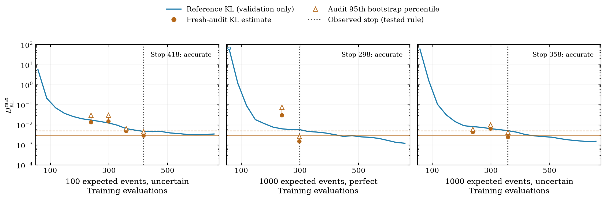
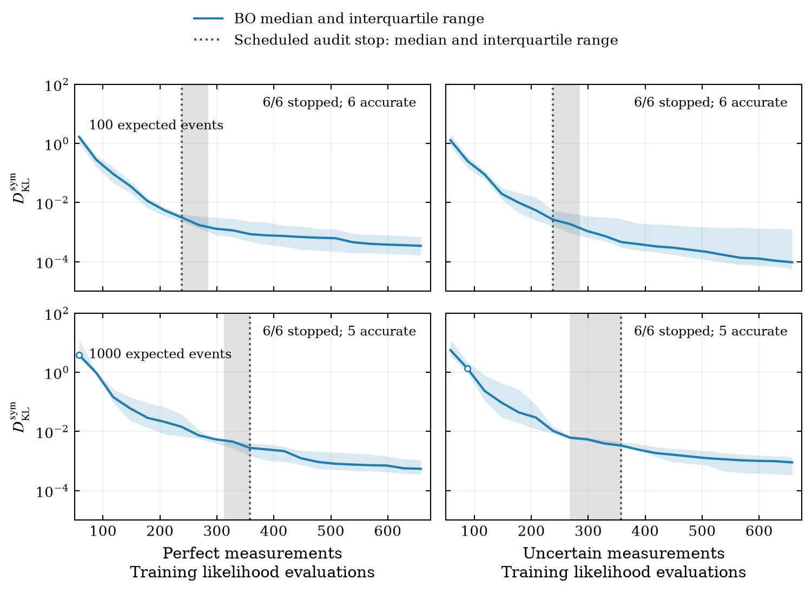
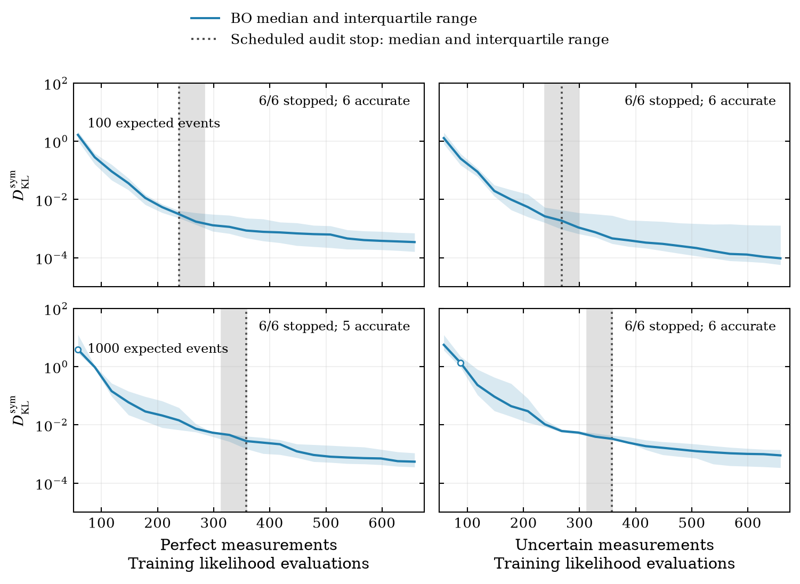
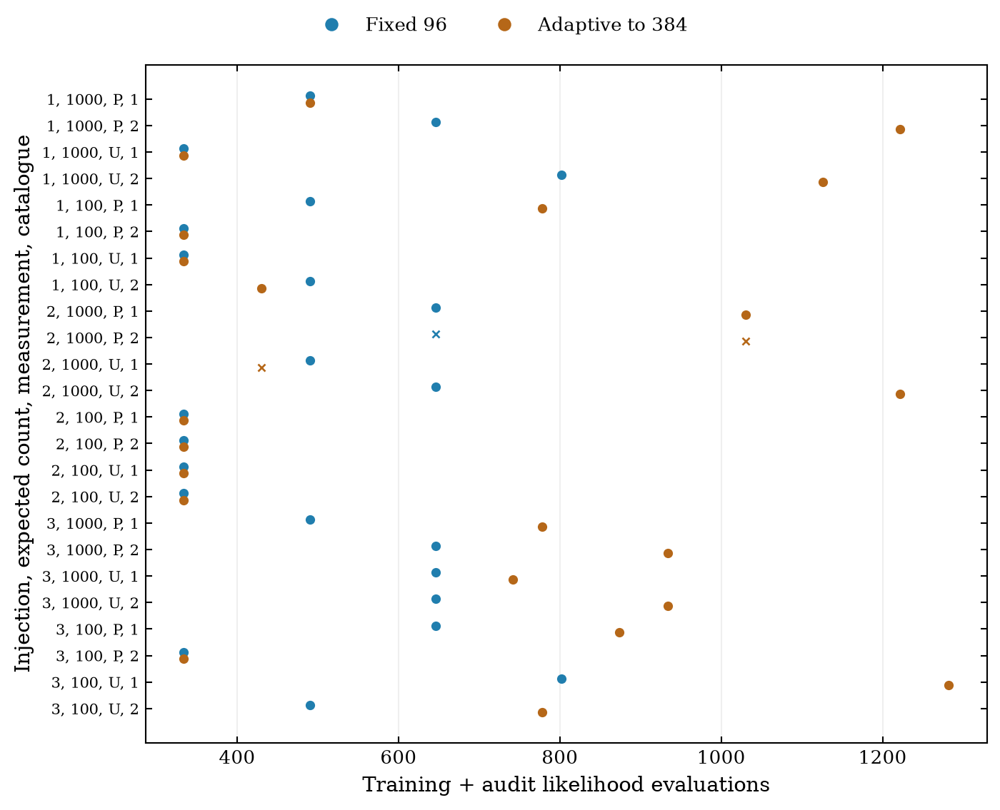

# Periodic-audit development results

Same 24 COMPAS likelihood cases and 48 frozen BO/random training trajectories as extension_v2. All are development evidence: the revision was motivated by already-seen failures. New audit coordinates and labels were generated without reading reference scores; all stopping decisions were frozen before this validation.

| Sampling | Audit | Accurate | Premature | Unresolved | No stop | Median training at stop | Median total at stop |
|---|---|---:|---:|---:|---:|---:|---:|
| BO | fixed96 | 23 | 1 | 0 | 0 | 298 | 490 |
| BO | adaptive384 | 22 | 2 | 0 | 0 | 298 | 760 |
| RANDOM | fixed96 | 0 | 0 | 0 | 24 | -- | -- |
| RANDOM | adaptive384 | 0 | 0 | 0 | 24 | -- | -- |

Accepted-stop medians exclude non-stops and include any premature stops. They are not end-to-end speedups. Full four-parameter accuracy is required: both directed KLs <0.01; all marginal means/endpoints <0.2 reference SD; 68/95% interval widths within 10%; and numerical precision checks. The earlier combined mass rule accepted 21/24 BO cases accurately and left three non-stops, with median 388 training and 484 total among accepted cases.

## Previously non-stopping cases

| Case | Fixed 96 training + audit | Adaptive training + audit | Adaptive result | Reference max KL |
|---|---|---|---|---:|
| t2_n100_uncertain_c0_bo | 418 + 384 | 418 + 864 | accurate | 0.0047444 |
| t2_n1000_perfect_c0_bo | 298 + 192 | 298 + 480 | accurate | 0.0058417 |
| t2_n1000_uncertain_c0_bo | 358 + 288 | 358 + 384 | accurate | 0.0051675 |



Blue: maximum directed reference KL, used only for validation. Orange circles: fresh audit estimates; triangles: 95th bootstrap percentiles. Solid/dashed orange horizontal lines are 0.003/0.005. At each checkpoint the final adaptive audit stage is shown; intermediate stages are retained in JSON. Dotted lines mark the actual adaptive stop. The x axis counts training labels; the table includes audit cost. These are the third injection and first catalogue. Bootstrap quantiles are finite-sample diagnostics, not confidence guarantees for the full posterior or repeated testing.



Blue median/IQR curves include all six BO cases in each panel; grey bands and dotted lines are conditional IQR/median accepted stopping locations. Counts explicitly distinguish stops from independently accurate stops. The y axis is symmetric KL (half the sum of both directions), so the blue curve alone is not the accuracy decision. Hollow blue circles retain unresolved numerical checkpoints. Top/bottom: 100/1000 expected events; left/right: perfect/uncertain measurements. Training continued after recorded stops for validation. Audit evaluations are excluded from this x axis.



Identical panel definitions for the fixed-96 comparator.



Fixed/adaptive audit costs include every rejected audit and only the labels spent before each policy accepted. Circles are accurate, crosses premature, squares unresolved, right triangles non-stops. Both policies share initial 96-point audit draws. Adaptive extra draws are held out of fixed-policy decisions.

## Scope and implementation

The schedule starts at 238 labels and repeats every 60, always including 658. Counter, posterior stability and pointwise residuals are diagnostics, not vetoes. Numerical integration and effective-sample-size checks remain necessary. Adaptive audits pool 96, 192 and 384 fresh samples at one frozen GP using the actual posterior/tempered/prior mixture density. See ../manifest.json and ../../SCHEDULED_AUDIT_PROTOCOL.md.

Audits remain held out of the saved GP training paths. Recycling failed audit labels into training and independently generated new-catalogue confirmation are not tested. The model has four physical parameters, with amplitude marginalized analytically and three GP inputs. Rate queries use the same fixed-population evaluator; cached rate references are used only for scoring. No new parameter-space reference grid or GPry installation was needed. All original extension_v2 decisions are retained.

Reproduce from the repository root with the existing virtual environment:

```sh
.venv/bin/python docs/studies/operational_stopping/gpry_compas/run_scheduled_audit.py --input docs/studies/operational_stopping/gpry_compas/extension_v2 --outdir FRESH_OUTPUT_DIRECTORY
.venv/bin/python docs/studies/operational_stopping/gpry_compas/score_scheduled_audit.py --input FRESH_OUTPUT_DIRECTORY
.venv/bin/python docs/studies/operational_stopping/gpry_compas/publish_scheduled_audit.py --input FRESH_OUTPUT_DIRECTORY
```
