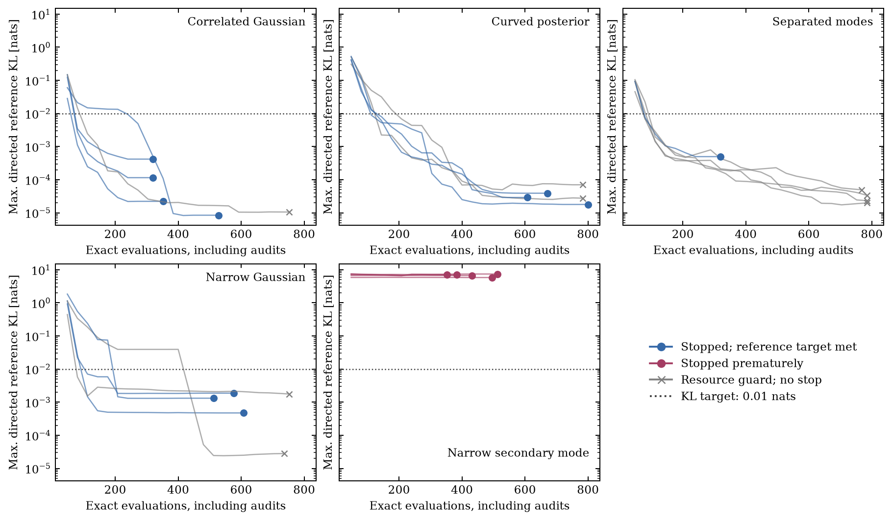
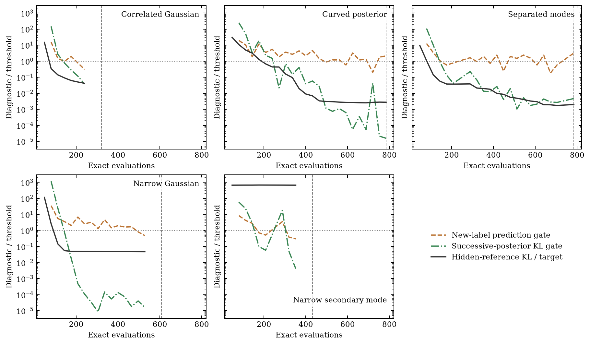
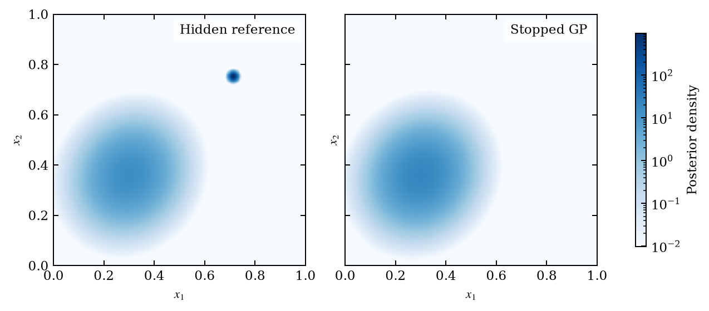
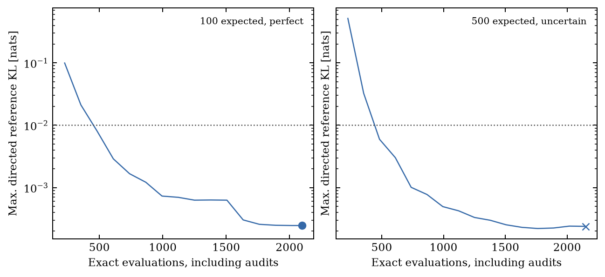

# Operational stopping: hidden-reference validation (v1)

**This candidate rule is not ready for general use.** It accepted incomplete posteriors in the narrow-secondary-mode stress test. It was also unnecessarily conservative on other targets; 9 of 9 resource-limited toy runs had accurate final posteriors.

The rule was frozen before 25 confirmation runs. The exact posterior reference was accessed only after each stopping decision was saved; all 25 decision hashes were checked. Development seed1000 is excluded.

Across 25 toy runs: **11 validated stops, 5 premature stops, 9 resource-limited runs without a stop, and 0 numerically unresolved reference assessments.**

| Toy family | Validated stops | Premature stops | No stop | Reference unresolved | Median calls among stops |
|---|---:|---:|---:|---:|---:|
| Correlated Gaussian | 4/5 | 0/5 | 1/5 | 0/5 | 336 |
| Curved posterior | 3/5 | 0/5 | 2/5 | 0/5 | 672 |
| Separated modes | 1/5 | 0/5 | 4/5 | 0/5 | 320 |
| Narrow Gaussian | 3/5 | 0/5 | 2/5 | 0/5 | 576 |
| Narrow secondary mode | 0/5 | 5/5 | 0/5 | 0/5 | 432 |

Each line is one frozen confirmation trajectory. Reference KL was computed afterwards on two independent quadratures; the larger directed value is shown. Dots are operational stops, crosses are resource guards. A final horizontal segment accounts for audit calls that did not refit the GP. The full accuracy target also includes marginal and numerical checks.

These panels show predeclared seed2000 in each family. The reference curve was hidden from stopping. Values below one pass the plotted component, but the full rule additionally requires marginal stability, numerical precision, consecutive checks and a fresh audit. The vertical line is the final decision or resource guard.

## Interpretation

Passing a finite GP-weighted audit is not a proof of global mode discovery. Resource-limited runs are retained even when their final posterior is already accurate. The evaluation counts include all audit calls; an accepted audit does not improve the fitted GP itself.

Five runs per family give a coarse failure-mode screen, not a precise rare-error rate or a universal guarantee. These are deterministic 2D densities, not noisy-catalogue coverage tests. No confirmation thresholds were retuned.

See [frozen protocol](../PROTOCOL.md), [source manifest](../confirmation_v1/manifest.json), and [all outcomes](../confirmation_v1/outcomes.json). Source snapshots identify the exact code loaded for this campaign; later dimensional generalization preserves its 2D defaults.

## A premature stop

This is the first premature stop in protocol family/seed order: Narrow secondary mode, seed2000. Both panels use the same prior and colour normalization. In the region x1 > 0.55, the reference places 30.09% of its probability, compared with 0.129% for the stopped GP. This illustrates an observed failure; it is not an omitted or retrained case.

## Separate COMPAS pilots

These two preselected original catalogues are implementation pilots, not a new calibration ensemble. References were loaded only after each operational decision. The GP uses three shape parameters; external validation also recovers the conditional SFR amplitude.

- n100_perfect: operational_stop, 2098 calls including audits; maximum directed reference KL 0.0002467; numerical check True.

- n500_uncertain: resource_limit, 2146 calls including audits; maximum directed reference KL 0.0002391; numerical check True.

Dots indicate an operational stop and crosses a resource guard. The final horizontal segment counts the accepted audit. Reference curves were hidden from stopping. The detailed pre-refit error locations are saved in `prediction_error_locations.json`; the 12-lnL diagnostic cutoff matches the broad audit relevance threshold and is not a general posterior-mass bound.
