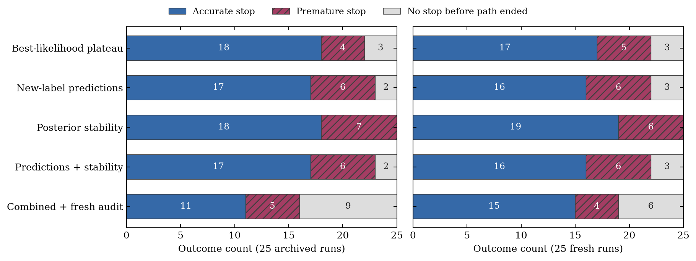
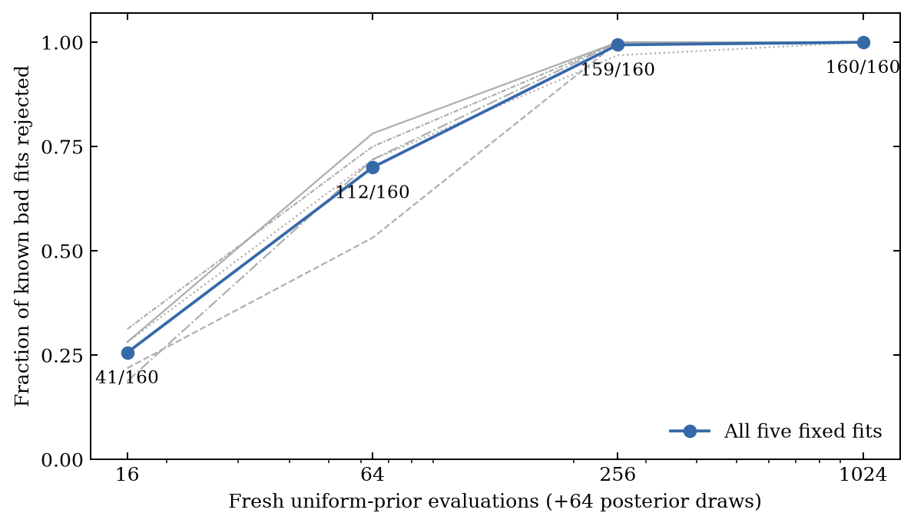

# Stopping BO without a reference GP or dense likelihood grid

**Recommended candidate: use posterior stability to trigger a small, fresh exact-likelihood audit; judge the audit by its effect on the posterior. Treat global exploration as a separate requirement.** None of the tested rules certifies that every mode has been found.

The operational checks use only successive GPs, already acquired labels, and a small number of new exact evaluations. Dense exact references are used afterwards to test the rules on tractable examples. They are not deployment inputs.

## Candidate rules and results

The baseline was rerun on 25 fresh targets: five seeds (3000–3004) for each of correlated, curved, two-mode, narrow, and narrow-secondary-mode likelihoods. All runs completed. Decision files were written before reference scoring; their hashes are checked by the comparison. The earlier 25 cases are retained separately.

| Rule | Accurate stops | Premature stops | No stop before path ended | Median calls among stops |
|---|---:|---:|---:|---:|
| Best-likelihood plateau | 17 | 5 | 3 | 176 |
| New-label predictions | 16 | 6 | 3 | 288 |
| Posterior stability | 19 | 6 | 0 | 208 |
| Predictions + stability | 16 | 6 | 3 | 288 |
| Combined + fresh audit | 15 | 4 | 6 | 512 |

Each panel contains 25 trajectories. The first four rules are prefix replays under the same acquisition policy; they do not alter acquisition or refitting. A non-stop is censored when that recorded path ends. The audited baseline was actually executed with an 800-call resource guard. Counts include initialization, acquisition and any audits already incurred along the source path; reference-evaluation costs are excluded. Medians include premature stops and must not be read as accuracy-equivalent savings.

A stop is accurate only if the independent reference assessment resolves numerically and both directed KLs are below 0.01, mean/interval endpoints differ by less than 0.2 reference SD, and 68% widths differ by less than 10%. These are posterior-approximation tests on deterministic 2D targets, not noisy-catalogue calibration or tests of finite-COMPAS adequacy.

- **Best-value plateau:** less than 0.01 lnL improvement across three updates. Cheap, but the maximum does not determine posterior width or secondary-mode mass.
- **Prediction accuracy:** two consecutive pre-refit batches pass the frozen v1 error thresholds in original lnL units. This costs no additional labels, but adaptive locations can miss important regions and tail errors can delay stopping.
- **Posterior stability:** two consecutive updates with joint KL below 0.001, mean/interval changes below 0.05 SD and 68% width changes below 3%. Independent GP-only quadratures must agree and each have ESS at least 100. A stable but wrong GP can pass.
- **Combined:** both prediction and stability checks pass twice.
- **Combined plus audit:** additionally check 64 fresh GP-posterior and 16 uniform-prior points before using their labels for training. This is the unchanged v1 rule.

## Fresh audit and posterior-impact refinement

At the first two-update stability trigger, a fresh 128-posterior/64-prior audit was evaluated. The original pointwise audit and the new importance-weighted audit score exactly the same paid labels. Rejected first-trigger audits remain rejected; these screens do not demonstrate the subsequent retraining path.

| Fresh first-trigger audit | Accurate acceptances | Premature acceptances | Rejected candidates |
|---|---:|---:|---:|
| Original pointwise score | 6 | 2 | 17 |
| Posterior-impact score | 17 | 3 | 5 |

All three premature impact-audit acceptances were narrow-secondary-mode targets. Among the other 20 fresh targets, it accepted 17 accurate fits and rejected three candidates. That is a conditional local result, not a general stopping guarantee.

The impact criterion was motivated by the two COMPAS pilot audits, then applied without threshold tuning to the fresh toys. COMPAS results are therefore development evidence. The first-trigger tests evaluate a fixed candidate GP, not a complete new adaptive stopping algorithm.

For audit points from a defensive mixture $q=(2/3)p_{GP}+(1/3)\pi$, compare normalized weights $w_{GP}\propto\exp(\ell_{GP})\pi/q$ and $w_{exact}\propto\exp(\ell_{exact})\pi/q$. In this study the prior is uniform on the unit box. Require estimated maximum-directed KL <0.005, mean/interval changes <0.05 GP SD, 68% width changes <3%, and both ESS values >=64. The GP normalization and posterior-draw approximation use a fresh cheap surrogate-only quadrature. These finite-sample estimates are not upper confidence bounds.

The identity $p_{exact}/p_{GP}=\exp(r)/E_{p_{GP}}[\exp(r)]$, where $r=\ell_{exact}-\ell_{GP}$, explains why this works locally: small variation in the residual implies small reweighting. A constant offset cancels for parameter inference; this does not validate evidence.

| COMPAS pilot | Audit decision | Calls including 192 fresh audit labels | Estimated audit KL | Offline reference KL at candidate |
|---|---|---:|---:|---:|
| n100_perfect | accepted | 1058 | 0.00051337 | 0.0012189 |
| n500_uncertain | accepted | 1186 | 0.00041111 | 0.0004958 |

These are two previously generated catalogue pilots, with newly evaluated audit coordinates. They are not a new catalogue ensemble. Their posterior residual RMS values were 0.034 and 0.028 lnL; the original pointwise audit rejected both on broad-region residuals of 0.53 and 0.66 lnL. The impact score was introduced to distinguish those errors from errors that materially change posterior mass.

## Global discovery cannot be inferred from local stability

Each grey line is one of the five archived GPs that missed a narrow secondary mode. For each fixed fit, 32 fresh audit seeds were used; broad-prior batches are nested within each repeat. The blue line pools 160 audits of five fixed fits, not 160 independent BO runs. The audit includes 64 posterior draws in addition to the plotted uniform-prior count. This experiment tests the original strict audit, not the new impact score.

| Uniform-prior probes | Bad fits rejected | Additional total audit calls |
|---:|---:|---:|
| 16 | 41/160 | 80 |
| 64 | 112/160 | 128 |
| 256 | 159/160 | 320 |
| 1024 | 160/160 | 1088 |

If a pre-specified detectable region occupies prior mass $v$, then $m$ IID prior probes miss it with probability $(1-v)^m$. A 95% chance of hitting that region needs:

| Minimum detectable prior volume | Required IID prior probes |
|---:|---:|
| 5% | 59 |
| 1% | 299 |
| 0.1% | 2,995 |
| 0.01% | 29,956 |

This is conditional on a fixed detectable region and a minimum-volume assumption. Adaptive training labels do not count as IID prior draws. Prior volume is not posterior mass: a tiny region may carry substantial posterior probability. Repeated audits with changing regions need a separate error-spending design if a formal sequential guarantee is desired.

## Practical stopping policy

1. Keep the scientific prior and broad exploration active. Monitor pre-refit prediction errors and best-value progress, but do not let either alone certify the posterior.
2. After two numerically resolved stable posterior updates, spend a fresh audit batch. Judge centered lnL residuals and the effect of exact-likelihood reweighting on joint density and credible intervals. Use original lnL units after inverse transformation.
3. On failure, add the audit points to training, reset the stability streak, and use fresh points at the next audit. Retain all training points, including far tails.
4. Report a local accuracy check separately from global exploration. Choose broad-probe effort using a scientifically defensible minimum feature scale, or state that global mode discovery is unresolved. Resource exhaustion is a separate outcome.

The numerical thresholds above are experimental starting values. The tests support studying posterior-impact audits for this pipeline; they do not justify an unconditional automatic production stop. No production defaults or existing running studies were changed.

## Reproduction and sources

The frozen comparison and later explicitly exploratory refinement are documented in [PROTOCOL.md](PROTOCOL.md). [compare_rules.py](../compare_rules.py) contains the selection and audit code; [publish_rule_comparison.py](../publish_rule_comparison.py) generates this report. The fresh campaign is [confirmation_fresh_3000](../confirmation_fresh_3000/manifest.json). Source snapshots and software-validation logs are retained alongside this report.

Run from the repository root with `OPENBLAS_NUM_THREADS=1 OMP_NUM_THREADS=1 MPLCONFIGDIR=/tmp/compas-mpl` and `.venv/bin/python`. Use new output directories. The commands are recorded in [reproduce.sh](reproduce.sh).

Software validation: **105 passed, 3 heavy/network tests deselected** in the default pytest suite. The existing Matplotlib deprecation warning remains. This validates software behavior, not the statistical reliability of the stopping rules.

The prediction/stability combination is motivated by [GPry's documented CorrectCounter and GaussianKL criteria](https://gpry.readthedocs.io/en/latest/module_convergence.html); the audit and thresholds here are our own experiments. [Järvenpää et al.](https://arxiv.org/abs/1905.01252) discuss GP uncertainty over normalized posteriors. GP uncertainty is useful only to the extent its model is calibrated, so it is not the sole stopping gate here.
