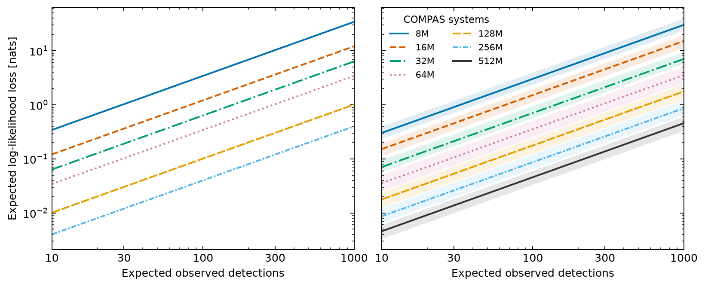
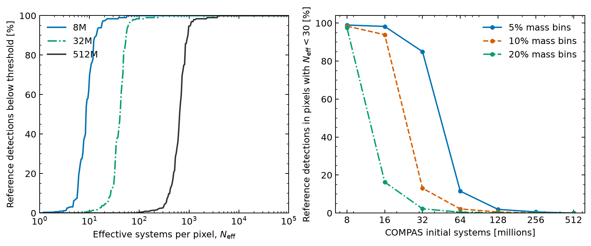

# Figure 9 extension: direct population calculations

The expected likelihood loss grows linearly with the number of observations.
The real population calculations determine each slope; changing observing
duration does not require another cosmic-integration run. Larger populations
usually reduce this discrepancy, but a particular nested subset is one
realization, not a measurement of mean bias.

**Figure caption.** Expected log-likelihood loss relative to the finite 512M
reference, at alpha = −0.3, sigma = 0.35, SFR amplitude = 0.01 and SFR exponent
= 4.7, using the fixed mass10 grid and nominal continuous measurement errors.
Left: actual nested population sizes; the full 512M reference is identically
zero and omitted from the logarithmic axis. Right: median and 16th–84th
percentiles from 128 populations per size resampled with replacement from 64
blocks of 8M initial systems. All blocks in a resample share the same weight
across bins and parameters. The nonzero 512M curve is a conditional bootstrap
estimate, not an independent simulation. Bands show population resampling
spread, not numerical integration uncertainty. Both panels use the same axes.
The observing-duration scaling assumes fixed selection and measurement errors.

At **1000 expected detections**, all losses below are in nats:

| Initial systems | Actual nested loss | Bootstrap median [16–84%] |
|---|---:|---:|
| 8M | 34.3 | 30.2 [24, 39.8] |
| 16M | 12.1 | 15.2 [11.4, 19.7] |
| 32M | 6.36 | 7.07 [5.75, 9.61] |
| 64M | 3.42 | 3.55 [2.53, 5.1] |
| 128M | 1.01 | 1.77 [1.27, 2.42] |
| 256M | 0.4 | 0.867 [0.66, 1.21] |
| 512M | 0 | 0.458 [0.333, 0.606] |

**Figure caption.** Support of actual nested populations at the same parameters.
Left: cumulative fraction of the full-reference detection rate in mass10 pixels
below a given effective-system count, including unsupported pixels at Neff = 0.
Right: that fraction below Neff = 30 for three fixed mass resolutions, all with
dz = 0.1. Effective counts use each binary's integrated pixel weight. The
threshold 30 is descriptive, not an accuracy requirement; the left panel shows
the full threshold dependence. Coarser grids retain exactly the same total rate.

For the 870-pixel mass10 grid:

| Initial systems | Selected systems | Positive pixels | Reference detections with Neff < 30 | Missing support |
|---|---:|---:|---:|---:|
| 8M | 20,752 | 162 / 870 | 98.41% | 1.068e-05% |
| 16M | 41,657 | 174 / 870 | 93.90% | 1.068e-05% |
| 32M | 83,145 | 182 / 870 | 13.07% | 7.432e-07% |
| 64M | 166,522 | 194 / 870 | 2.16% | 1.315e-07% |
| 128M | 332,201 | 200 / 870 | 0.55% | 1.315e-07% |
| 256M | 664,053 | 206 / 870 | 0.00% | 1.314e-07% |
| 512M | 1,326,573 | 214 / 870 | 0.00% | 0% |

**Simple interpretation.** Small COMPAS populations can leave observable parts
of a fine grid poorly supported. Coarser pixels reduce this problem but also
discard distribution detail; they do not improve the total-rate estimate.
Raw occupancy alone is insufficient because the cosmic weights are unequal.
An adequate grid therefore depends on the population size, weights, measurement
precision and catalogue size, rather than a universal number of pixels per 8M
systems. Redshift cells receive correlated contributions from the same binary.

For this injection, moving from 5% to 10% to 20% mass bins reduces the fraction
below Neff = 30 from **85% to 13% to 2.2% for 32M**. For 8M it stays above
97% for all three grids: these modest coarsenings alone do not provide strong
pixel support. Measurement uncertainty averages contributions across pixels,
so pixel Neff is a support diagnostic, not an event-likelihood error estimate.

**Scope and checks.** This estimates discrepancy and conditional resampling
variability within one archive, not absolute bias relative to an infinite
population, missing evolutionary channels, or posterior calibration. The blocks
must be exchangeable for a bootstrap interpretation; the archive does not
establish independent-run provenance. Only parameter-dependent likelihood
errors can shift a posterior; these plots alone do not establish a parameter
bias. Perfect measurements have infinite expected losses wherever the finite
candidate misses reference support; no rate floor is introduced. Gaussian
measurement tails are evaluated in log space when ordinary arithmetic underflows.

Every block's sparse predictions were checked against the direct integrator,
and the rebuilt 32M/128M/256M/512M predictions match the previous Figure 9 cache.
Two integrations use 262,144 measurements each;
the maximum estimated numerical standard error is
0.73% of a nonzero loss.
Numerical status: **complete**. Full pixel counts, three descriptive
thresholds (10/30/100), missing-support fractions and exact perfect-bin losses
are in [grid_support.csv](grid_support.csv). Rates at five nearby sigma values
are also cached for a follow-up check of parameter dependence.
