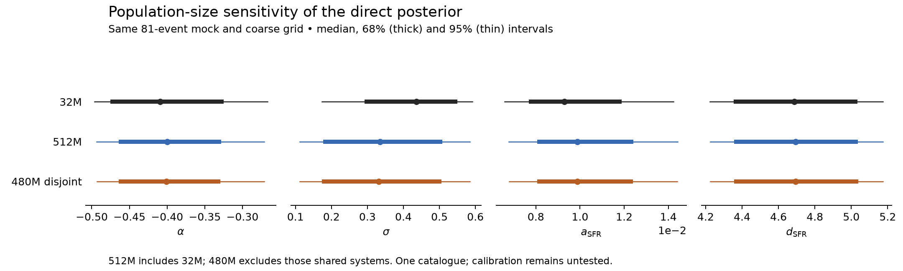
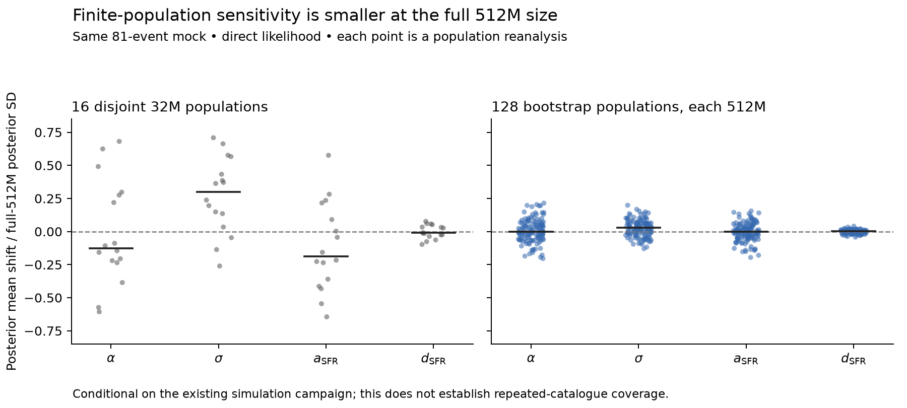

# Finite-population sensitivity

This study holds the ideal 81-event mock catalogue, mass10 grid, priors and O3
selection approximation fixed. It uses the direct likelihood, without a GP.

The 32M file is an exact prefix of 512M in all audited system fields (SEED, initial
masses, metallicity) and DCO fields (SEED, masses, formation/coalescence times).
Neither file contains root metadata establishing independent run provenance.
The streamed loader also verifies that every selected 32M system has identical
mass, metallicity and delay time in 512M. Hence the two files cannot be treated
as independent realizations.

`population_stream.py` reads system and common-envelope records in chunks. It
joins metallicities by SEED and rejects missing/duplicate matches. It supports
only the ALL, Hubble-merging, pessimistic/no-immediate-RLOF selection used here.
The original 32M loader and streamed extraction must agree exactly before the
large population is used. Both populations share the seed-0 selection object
and mass-per-binary normalization; simulation-population variation is not mixed
with rerandomization of those auxiliary Monte Carlo calculations.

The sparse contraction is built in batches of 10000 systems. Subtracting the
32M operator from the 512M operator *before population normalization* produces
the disjoint 480M remainder. Its normalization uses 480 million evolved systems.
All shared selected systems are checked before subtraction. The observed
metallicity log-range normalization differs between the files by about 7e-9
relative; this legacy behavior is retained and recorded.

Two independently scrambled full-prior Sobol integrations, each with 8192 points,
use the same points across populations. The amplitude is integrated analytically;
its conditional truncated-Gamma draw uses the fourth Sobol coordinate. Weighted
quantiles and effective sample size are reported. We compare against the earlier
32M direct chains and between scrambles to assess integration error. These are
weighted numerical integrations, not MCMC chains or repeated mock catalogues.

Reproduce from the repository root:

```bash
.venv/bin/python docs/studies/population_stability/audit_files.py
MPLCONFIGDIR=/tmp/compas-grid-matplotlib .venv/bin/python docs/studies/population_stability/compare_populations.py
MPLCONFIGDIR=/tmp/compas-grid-matplotlib .venv/bin/python docs/studies/population_stability/plot_comparison.py
```

The named output files are overwritten on rerun. `file_audit.json` records sizes,
shapes, seed endpoints and exact prefix checks. `results/` contains sparse
operators, weighted posterior points, numerical comparisons and a source/input
manifest. A stored operator alone is not a complete rate model: the original
metallicity/SFR formulas, normalization, and integration grid must also match.

## Result: 32M fails the chosen stability tolerance for this mock

The full comparison completed in 143.9 s excluding Python imports. The selected
DCO counts are 83,145 (32M) and 1,326,573 (512M). The batched operator agrees with
original 32M rate grids at three fiducial/boundary probes, with maximum absolute
rate differences below 2.2e-14. The legacy metallicity row order also agrees for
both files; the explicit join does not silently change the existing target.

Relative to the independently sampled 32M reference:

| Parameter | 512M mean shift / 32M SD | 512M / 32M 68% width | 480M remainder mean shift / 32M SD | Remainder / 32M 68% width |
|---|---:|---:|---:|---:|
| alpha | +0.062 | 0.891 | +0.056 | 0.885 |
| sigma | -0.714 | 1.260 | -0.738 | 1.264 |
| SFR a | +0.228 | 1.049 | +0.224 | 1.041 |
| SFR d | +0.005 | 1.008 | +0.009 | 1.007 |



Sigma's lower 68% endpoint moves by ~0.97 of the 32M posterior SD. Its median
changes from ~0.439 in the 32M chain (~0.436 in the independent quadrature) to
~0.335 with 512M. These changes exceed the provisional 0.2-SD/10%-width tolerances.
The fiducial total rate changes only from 729.499 to 728.736 detections/year
(~0.105%). A stable total rate therefore does **not** establish stable constraints.

The quadrature ESS values are ~2854 (32M), ~3288 (512M) and ~3217 (remainder).
Between scrambles, all parameter means agree within 0.00036 of the 32M marginal
SD. The 32M quadrature agrees with the independent chains within 0.027 SD in means
and ~2% in 68% widths. Numerical integration uncertainty does not explain the
observed sigma shift.

**Interpretation:** this isolates population dependence without a GP. It does
not prove that 512M is converged or that 32M is biased in the same direction for
every catalogue. The mock was generated with 32M, so it is not an independent
physical truth. Agreement between 512M and its 480M remainder is not a second
independent convergence test: those two share almost all systems. What matters
here is that the 32M-versus-disjoint-480M comparison also changes sigma materially.

Next: compare disjoint population blocks (e.g. the two 256M halves, and smaller
blocks if inexpensive) to estimate realization scatter and locate a manageable
population size. Obtain independent-run/configuration provenance where available.
Defer the repeated-catalogue calibration campaign until a population-size choice
is supported. Do not spend more time tuning the GP against an unstable 32M target.

## Existing-budget block bootstrap (2026-09-08)

`bootstrap_blocks.py` partitions the 512M file by system-row membership into
sixteen disjoint 32M blocks. The streamed loader now retains each selected DCO's
system-row index. This ensures a partition of evolved systems, not equal counts
of selected mergers. Summed block operators reproduce the prior full-512M
operator to relative error 9.70e-16. All blocks use the full-run metallicity
support/normalization, and bootstrap populations always represent 512M systems.

For each of 128 bootstrap replicates, sixteen blocks are drawn with replacement.
The resulting multiplicity of each block is fixed across every parameter point
and mass/redshift bin. This is a **block bootstrap**, not an individual-binary
bootstrap or a new simulation. It assumes blocks are exchangeable under the same
simulation design; that assumption is not guaranteed by file metadata. There
are only sixteen original blocks, however many bootstrap replicates are drawn.

The two disjoint 256M halves differ from the full-run posterior by at most
0.063 marginal SD in means and 1.3% in 68% widths. Full-size bootstrap results:

| Parameter | SD of bootstrap posterior means / nominal posterior SD | 5th–95th percentile of bootstrap 68% width / nominal width |
|---|---:|---:|
| alpha | 0.088 | 0.933–1.065 |
| sigma | 0.064 | 0.979–1.011 |
| SFR a | 0.070 | 0.942–1.068 |
| SFR d | 0.014 | 0.999–1.001 |

Thus the earlier 32M/512M discrepancy does not imply comparably large uncertainty
in the full 512M result. Population variability remains measurable: at the 95th
percentile of bootstrap replicates, the maximum shift of either 68% endpoint is
0.216 SD (alpha), 0.127 SD (sigma), 0.235 SD (SFR a), and 0.022 SD (SFR d).
This is not an unconditional pass of every original 0.2-SD tolerance.

The posterior-weighted RMS standard deviation of relative marginalized lnL
(across bootstrap replicates, anchored at one fixed high-posterior point) is
0.330. No pointwise independent noise or variance correction was added to lnL.

Pooling the normalized bootstrap posteriors gives measured 68% width ratios
1.0065, 0.9984, 1.0024, 1.0005. **This is only a sensitivity summary**, not a
Bayesian marginal likelihood or corrected posterior. Small pooled changes do
not erase the shifts of individual resampled posteriors. Sub-percent width
changes should not be overinterpreted: numerical quantile precision, especially
for amplitude, is not sufficient to resolve every such difference.

The smallest bootstrap quadrature ESS is 2713. An independent Sobol scramble of
the nominal target agrees in means within 0.00031 SD. Repeating eight bootstrap
replicates with the second scramble gives maximum mean discrepancies <0.00053 SD
and quantile discrepancies <0.030 SD (amplitude; other parameters <0.0022 SD).
This is much smaller than the measured mean scatter. Main run time: 80.9 s,
including loading, all block operators, two rate grids, and the bootstrap.
41 fast tests pass, including streamed row membership and batched/scalar
amplitude-integral parity.



```bash
MPLCONFIGDIR=/tmp/compas-grid-matplotlib .venv/bin/python docs/studies/population_stability/bootstrap_blocks.py
MPLCONFIGDIR=/tmp/compas-grid-matplotlib .venv/bin/python docs/studies/population_stability/check_bootstrap_numerics.py
MPLCONFIGDIR=/tmp/compas-grid-matplotlib .venv/bin/python docs/studies/population_stability/plot_bootstrap.py
```

`block_results/` retains operators, cached block-rate grids, bootstrap
multiplicities, posterior summaries, a provenance manifest and numerical checks.
The main runner refuses changed-provenance cache reuse. Bootstrap intervals do
not measure missing channels, common simulation/model systematics, or repeated
catalogue coverage. This remains the one 81-event ideal mock generated with the
first 32M block. No GP was trained or altered by this experiment.

**Decision:** the existing 512M population is a promising basis for the next
noisy-catalogue calibration pilot. No larger COMPAS run is requested. Carry the
measured population sensitivity forward; do not repair the inaccurate GP mean
by assigning it this comparatively small bootstrap uncertainty. Test predictive
coverage with disjoint mock-generation and inference populations before making
a calibrated-constraint claim or fitting an extra latent-uncertainty model.
